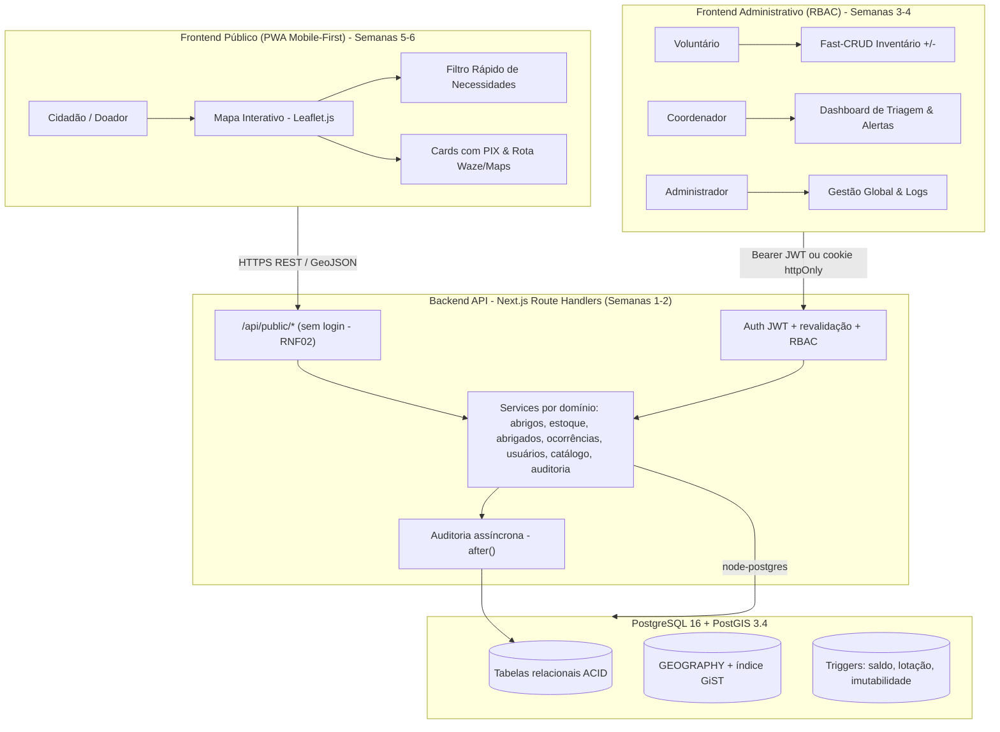

# Arquitetura e Tecnologias - WhereToGo

Baseado na Seção 2 do DVP (Projeto Técnico), atualizado com o que foi implementado até a Semana 2.

## 1. Arquitetura Utilizada
**Cliente-Servidor em monólito modular** com Next.js: o mesmo projeto entrega o frontend (mapa público e painel) e a **API REST** (Route Handlers em `src/app/api`). Banco relacional PostgreSQL com extensão espacial PostGIS.



### 1.1. Camadas do backend
| Camada | Local | Responsabilidade |
|---|---|---|
| Rotas (HTTP) | `src/app/api/**/route.ts` | autenticar (`exigirContexto`), validar entrada (Zod), chamar o service, montar a resposta `{ dados }` |
| Services (regras de negócio) | `src/modules/<dominio>/*.service.ts` | **autorização RBAC** (`exigirPermissao`), regras de negócio, SQL parametrizado, transações, auditoria |
| Infra compartilhada | `src/lib` | conexão (`db.ts`), erros/HTTP (`http.ts`), JWT/sessão/RBAC (`auth/`), auditoria (`auditoria.ts`), validação (`validacao.ts`) |
| Banco | `db/migrations` | schema, constraints, triggers de integridade, dados de referência |

### 1.2. Decisões técnicas
1. **SQL versionado + `pg` em vez de ORM (Prisma).** O modelo depende de recursos que ORMs não representam bem: tipo `GEOGRAPHY` com coluna gerada e índice GiST, índice único parcial, CHECKs e triggers. Migrations SQL deixam o modelo lógico explícito e evitam "drift" entre o schema do ORM e o banco. Todas as consultas usam parâmetros (`$1`), sem concatenação de entrada do usuário.
2. **Invariantes no banco, políticas na API.** Saldo de estoque, lotação, status de infraestrutura e imutabilidade de logs são garantidos por triggers (valem para qualquer caminho de escrita). Permissões, capacidade e campos editáveis por papel ficam nos services.
3. **JWT stateless + revalidação por requisição.** O token (HS256, `jose`) carrega `id`, `nome`, `email`, `papel` e `idAbrigo`. A cada requisição o usuário é relido no banco (consulta por PK): desativar um usuário, trocar seu papel ou desativar seu abrigo tem efeito imediato.
4. **Auditoria assíncrona com `after()`.** O INSERT em `LOG_AUDITORIA` roda depois do envio da resposta (RNF03 sem somar latência ao Fast-CRUD). O histórico de estoque (`MOVIMENTACAO_ESTOQUE`), por ser dado de negócio, é gravado na mesma transação da alteração.
5. **Cache Components ligado, API sempre dinâmica.** O wrapper `rota()` chama `connection()` para que nenhuma rota da API seja pré-renderizada no build; as respostas públicas usam `Cache-Control` curto (`s-maxage=10`) para CDN (RNF01).
6. **Respostas e erros padronizados.** Sucesso: `{ "dados": ... }`. Erro: `{ "erro": { "codigo", "mensagem", "detalhes?" } }`. Violações do banco (ex.: `estoque_abrigo_quantidade_ck`) viram códigos de negócio (`ESTOQUE_INSUFICIENTE`).

### 1.3. Divergências em relação ao DVP (atualizar no documento)
- O DVP cita **"Node.js (NestJS ou Express)"** para o backend; o projeto adotou **Next.js Route Handlers** (monólito modular com frontend e API no mesmo deploy), como já previsto na arquitetura destes specs.
- O DVP cita **PostgreSQL 15+**; o ambiente usa **PostgreSQL 16 + PostGIS 3.4**.
- O DVP lista **Node 20+**; o Node 20 chegou ao fim de vida em abril/2026, então a imagem usa **Node 22 LTS**.
- O modelo de dados da Seção 2.3 (v1) foi substituído pelo **DER v2 revisado** (ver `04-database-model.md`).

---

## 2. Tecnologias e Ferramentas

| Tecnologia | Versão | Objetivo e Justificativa Técnica |
|---|---|---|
| **Next.js / React** | 16.4 / 19.3 | Frontend + Route Handlers (API REST) no mesmo projeto; `output: standalone` para imagem Docker enxuta. |
| **Node.js** | 22 LTS | Runtime assíncrono, alto throughput de I/O para o Fast-CRUD. |
| **TypeScript** | 5.x | Tipagem estática em todo o backend. |
| **PostgreSQL** | 16 | Banco relacional ACID com integridade referencial, CHECKs e triggers. |
| **PostGIS** | 3.4 | `GEOGRAPHY(POINT)`, `ST_Distance`/`ST_DWithin` e índice GiST para proximidade (RF08). |
| **node-postgres (`pg`)** | 8.x | Driver com pool de conexões e consultas parametrizadas. |
| **Zod** | 4.x | Validação de entrada com mensagens em pt-BR. |
| **jose** | 6.x | Assinatura/verificação de JWT (RFC 7519) - HS256. |
| **bcryptjs** | 3.x | Hash de senhas (custo 12). |
| **Vitest** | 5.x | Testes unitários, de integração (banco real) e e2e HTTP. |
| **Leaflet.js** | Mais recente | (Semana 5) Renderização de mapas leve; a API já entrega GeoJSON. |
| **Docker & Docker Compose** | Multi-stage | `postgres` (PostGIS) + job `migrate` + `app` (standalone, usuário não-root, healthcheck). |

---

## 3. Estrutura de pastas

```
.docker/                    Dockerfile multi-stage + init do PostgreSQL
db/migrations/              0001 schema · 0002 triggers · 0003 dados de referência
scripts/                    migrate.mjs (executor de migrations) · seed.mjs (dados de desenvolvimento)
src/app/api/                Route Handlers (rotas REST)
src/lib/                    db, http, validação, auditoria, auth (jwt, sessão, rbac, senha)
src/modules/<dominio>/      services: abrigos, estoque, abrigados, ocorrencias, catalogo, usuarios, auditoria, publico
tests/unit|integration|e2e  Vitest (integração usa um banco PostGIS real recriado a cada execução)
.specs/                     documentação de contexto, requisitos e tarefas
```
