# Modelo Lógico do Banco de Dados - WhereToGo (DER v2 revisado)

Base: DER v2 do draw.io (`DER_WhereToGo.drawio`), que substitui o modelo da Seção 2.3 do DVP (v1, 5 tabelas), com as correções descritas na seção 2.
Implementação: `db/migrations/0001_schema_inicial.sql`, `0002_regras_de_integridade.sql` e `0003_dados_de_referencia.sql` (PostgreSQL 16 + PostGIS 3.4).

---

## 1. Diagrama de Entidade-Relacionamento (revisado)

> Para atualizar o draw.io: *Organizar > Inserir > Avançado > Mermaid* e cole o bloco abaixo.

```mermaid
erDiagram
    %% Categorização e Estoque
    CATEGORIA_ITEM ||--o{ ITEM : "subdivide em"
    ITEM ||--o{ ESTOQUE_ABRIGO : "controlado em"
    ABRIGO ||--o{ ESTOQUE_ABRIGO : "mantem"
    STATUS_NECESSIDADE ||--o{ ESTOQUE_ABRIGO : "classifica urgencia de"

    %% Histórico transacional de estoque (livro-razão)
    ABRIGO ||--o{ MOVIMENTACAO_ESTOQUE : "origina"
    ABRIGO |o--o{ MOVIMENTACAO_ESTOQUE : "contraparte de transferencia"
    ITEM ||--o{ MOVIMENTACAO_ESTOQUE : "movimenta"
    USUARIO ||--o{ MOVIMENTACAO_ESTOQUE : "executa"

    %% Gestão de acessos
    PAPEL_USUARIO ||--o{ USUARIO : "atribui permissao a"
    ABRIGO |o--o{ USUARIO : "aloca (0 ou 1)"

    %% Acolhidos e transferências
    ABRIGO ||--o{ ABRIGADO : "abriga atualmente"
    ABRIGADO ||--o{ TRANSFERENCIA_ABRIGADO : "possui historico de"
    ABRIGO ||--o{ TRANSFERENCIA_ABRIGADO : "sai de (origem)"
    ABRIGO ||--o{ TRANSFERENCIA_ABRIGADO : "vai para (destino)"
    USUARIO ||--o{ TRANSFERENCIA_ABRIGADO : "autoriza"

    %% Infraestrutura (RF05 / RF09) - entidade adicionada
    ABRIGO ||--o{ OCORRENCIA_INFRAESTRUTURA : "reporta"
    USUARIO ||--o{ OCORRENCIA_INFRAESTRUTURA : "registra / resolve"

    %% Auditoria geral
    USUARIO |o--o{ LOG_AUDITORIA : "gera (0 ou 1)"
    ABRIGO |o--o{ LOG_AUDITORIA : "registra eventos de (0 ou 1)"

    CATEGORIA_ITEM {
        int id PK
        string nome_macro "Unique"
        string slug "Unique - filtros do mapa"
    }

    ITEM {
        int id PK
        int id_categoria FK
        string nome_micro "Unique"
        string unidade_medida
        boolean ativo
    }

    STATUS_NECESSIDADE {
        int id PK
        string codigo "Unique - URGENTE, NORMAL, BLOQUEADO"
        string descricao
        int nivel_prioridade "Unique - 1 = maior"
    }

    ESTOQUE_ABRIGO {
        int id_abrigo PK, FK
        int id_item PK, FK
        int id_status_necessidade FK
        int quantidade ">= 0 - derivada das movimentacoes"
        int quantidade_minima ">= 0"
        timestamptz atualizado_em
    }

    MOVIMENTACAO_ESTOQUE {
        bigint id PK
        int id_abrigo FK
        int id_item FK
        int id_usuario FK
        int id_abrigo_contraparte FK "Nullable"
        string tipo_movimentacao "ENTRADA_DOACAO, SAIDA_CONSUMO, PERDA, TRANSFERENCIA_ENTRADA, TRANSFERENCIA_SAIDA, AJUSTE"
        int quantidade "com sinal"
        int quantidade_resultante
        timestamptz data_hora
        string observacao
    }

    ABRIGO {
        int id PK
        string nome
        string endereco
        string telefone
        string chave_pix
        string titular_pix
        float latitude
        float longitude
        geography localizacao "gerada - PostGIS"
        int capacidade_maxima "> 0"
        int lotacao_atual "cache - trigger"
        string status_infraestrutura "NORMAL, ALERTA, CRITICO - trigger"
        boolean ativo
        timestamptz criado_em
        timestamptz atualizado_em
    }

    PAPEL_USUARIO {
        int id PK
        string nome "Unique - ADMIN, COORDENADOR, VOLUNTARIO"
        string descricao
    }

    USUARIO {
        int id PK
        int id_papel FK
        int id_abrigo FK "Nullable - nulo somente para ADMIN"
        string nome
        string email "Unique"
        string senha_hash
        boolean ativo
        timestamptz criado_em
        timestamptz atualizado_em
    }

    ABRIGADO {
        int id PK
        int id_abrigo_atual FK
        string nome_completo
        string cpf "Unique, Nullable"
        date data_nascimento "Nullable"
        timestamptz data_entrada
        timestamptz data_saida "Nullable"
        string status_acolhimento "PRESENTE, DESLIGADO"
    }

    TRANSFERENCIA_ABRIGADO {
        int id PK
        int id_abrigado FK
        int id_abrigo_origem FK
        int id_abrigo_destino FK
        int id_usuario FK
        timestamptz data_transferencia
        string motivo
    }

    OCORRENCIA_INFRAESTRUTURA {
        int id PK
        int id_abrigo FK
        int id_usuario_registro FK
        int id_usuario_resolucao FK "Nullable"
        string tipo "SEM_ENERGIA, SEM_AGUA, VIA_BLOQUEADA..."
        string gravidade "ALERTA, CRITICO"
        string descricao
        float latitude "Nullable"
        float longitude "Nullable"
        timestamptz data_registro
        timestamptz data_resolucao "Nullable"
    }

    LOG_AUDITORIA {
        bigint id PK
        int id_usuario FK "Nullable - eventos anonimos de seguranca"
        int id_abrigo FK "Nullable"
        string acao "codigo"
        string descricao
        jsonb detalhes
        timestamptz data_hora
        string endereco_ip
    }
```

---

## 2. Análise do DER v2 frente ao escopo do projeto

### 2.1. O que o DER v2 resolve bem (em relação ao modelo v1 do DVP)
- **Categoria macro + item micro** (`CATEGORIA_ITEM` → `ITEM`): permite os filtros por tipo de doação do mapa (RF08: "água", "cobertores") sem perder o detalhe do item no estoque (RF02).
- **Tabelas de domínio** para papéis (`PAPEL_USUARIO`) e níveis de necessidade (`STATUS_NECESSIDADE`): normalização e prioridade ordenável.
- **Histórico transacional de estoque** (`MOVIMENTACAO_ESTOQUE`): rastreabilidade de cada entrada/saída (anti-desvio, RNF03).
- **Acolhidos e transferências** (`ABRIGADO`, `TRANSFERENCIA_ABRIGADO`): lotação baseada em pessoas reais e histórico de deslocamentos entre abrigos.
- **Chave composta** em `ESTOQUE_ABRIGO (id_abrigo, id_item)` garante um único saldo por item/abrigo.

### 2.2. Inconsistências encontradas e correções aplicadas

| # | Problema no DER v2 | Impacto | Correção aplicada |
|---|---|---|---|
| 1 | `ABRIGO.lotacao_atual` e `ABRIGADO` guardam a mesma informação de forma independente. | Duas fontes de verdade: a lotação exibida no mapa podia divergir das pessoas registradas. | `lotacao_atual` virou **cache mantido por trigger** (`fn_atualizar_lotacao_abrigo`) a partir dos abrigados `PRESENTE`. A API não permite editá-la. |
| 2 | `ABRIGADO.status_acolhimento = "Transferido"` contradiz `id_abrigo_atual` + `TRANSFERENCIA_ABRIGADO`. | Uma pessoa transferida está **presente no destino**; com status "Transferido" não contaria na lotação de nenhum abrigo. | Domínio reduzido a `PRESENTE`/`DESLIGADO` + coluna `data_saida`. A transferência é um evento do histórico, não um estado. |
| 3 | `MOVIMENTACAO_ESTOQUE.tipo = "TRANSFERENCIA"` sem direção nem abrigo de destino; `quantidade` sem sinal. | Impossível saber se a transferência foi entrada ou saída, nem para onde foi o item. Sem tipo para correção de inventário. | Tipos `TRANSFERENCIA_ENTRADA`/`TRANSFERENCIA_SAIDA` + `id_abrigo_contraparte`; novo tipo `AJUSTE` (contagem física); `quantidade` **com sinal** validado por CHECK; `quantidade_resultante` (saldo após a operação). |
| 4 | `ESTOQUE_ABRIGO.quantidade` e `MOVIMENTACAO_ESTOQUE` não têm vínculo de consistência. | O saldo podia ser alterado sem registro no histórico (ou vice-versa). | O saldo só muda por meio de uma movimentação: trigger `fn_aplicar_movimentacao_estoque` aplica o delta na mesma transação. Invariante: **saldo = Σ movimentações**. Saldo negativo aborta a operação. |
| 5 | `USUARIO` sem indicador de ativo. | HU01 RN3 exige negar acesso a usuários inativos — não havia como representar isso (e excluir quebraria a autoria dos logs). | `ativo` (desativação em vez de exclusão) + trigger `fn_validar_vinculo_usuario`: ADMIN **sem** abrigo; COORDENADOR/VOLUNTARIO **com** abrigo. |
| 6 | `ABRIGO` sem endereço, telefone, chave PIX e sem indicador de ativo. | RF07 (card com endereço, contato e PIX oficial) e RF06 ("abrigos **ativos**") não eram atendíveis. | Colunas `endereco`, `telefone`, `chave_pix` + `titular_pix` (exigidas juntas) e `ativo`. |
| 7 | `ABRIGO.status_infraestrutura` é um único texto. | Não representa incidentes simultâneos (sem energia **e** via colapsada), não guarda quem reportou nem quando, e não tem localização para os alertas do mapa (RF05/RF09). | Nova entidade **`OCORRENCIA_INFRAESTRUTURA`** (tipo, gravidade, local opcional, registro/resolução com autoria). `status_infraestrutura` passou a ser o **resumo** (`NORMAL`/`ALERTA`/`CRITICO`) mantido por trigger. |
| 8 | RF04 usa "itens abaixo do limite mínimo", mas o DER não tem esse limite. | Alerta de estoque crítico do dashboard sem base de dados. | `ESTOQUE_ABRIGO.quantidade_minima` (por abrigo, pois cada abrigo tem um porte). |
| 9 | `STATUS_NECESSIDADE` só tem `descricao` (texto livre); `PAPEL_USUARIO.nome` sem unicidade. | Regras de negócio (filtro URGENTE, exclusão de BLOQUEADO, RBAC) dependeriam de comparar textos editáveis. | `STATUS_NECESSIDADE.codigo` (único) e `nivel_prioridade` único; `PAPEL_USUARIO.nome` único e em formato de código. |
| 10 | `CATEGORIA_ITEM` sem identificador estável; `ITEM` sem forma de sair do catálogo. | Os ícones de filtro do mapa dependeriam de ids que mudam entre ambientes; excluir item quebraria o histórico. | `CATEGORIA_ITEM.slug` (ex.: `agua`) e `ITEM.ativo`. |
| 11 | `LOG_AUDITORIA.acao` como texto único; `id_usuario` obrigatório. | Difícil filtrar por tipo de evento; impossível registrar tentativas de login com e-mail inexistente (auditoria de segurança do ADMIN). | `acao` = **código** (ex.: `ESTOQUE_MOVIMENTADO`), `descricao` legível ("+1 Água Potável 5 L") e `detalhes` JSONB (antes/depois). `id_usuario` anulável **apenas** para eventos anônimos de segurança. |
| 12 | Imutabilidade do RNF03 apenas declarada. | Logs e histórico poderiam ser alterados/apagados, anulando a auditoria. | Triggers bloqueiam `UPDATE`, `DELETE` e `TRUNCATE` em `LOG_AUDITORIA`, `MOVIMENTACAO_ESTOQUE` e `TRANSFERENCIA_ABRIGADO` (erro `WTG01`). |
| 13 | Coordenadas como `float` sem recurso espacial; datas como `timestamp`. | A arquitetura prevê PostGIS para "abrigo mais próximo do doador" (RF08); `timestamp` sem fuso gera ambiguidade. | `DOUBLE PRECISION` + coluna `localizacao GEOGRAPHY(POINT,4326)` **gerada** a partir de lat/lng com índice **GiST**; todas as datas em `TIMESTAMPTZ`. |
| 14 | Restrições de integridade ausentes. | Dados inválidos (estoque negativo, capacidade zero, CPF malformado, transferência para o mesmo abrigo). | CHECKs e UNIQUEs nomeados (ver seção 3) traduzidos pela API em mensagens de negócio. |
| 15 | Desenho do draw.io diverge do próprio Mermaid embutido. | Documentação visual incorreta. | No desenho faltam as arestas **"vai para (destino)"** (ABRIGO→TRANSFERENCIA_ABRIGADO) e **"registra eventos de"** (ABRIGO→LOG_AUDITORIA); a aresta "sai de (origem)" foi rotulada "movimentação" e ligada à linha `capacidade_maxima` em vez da tabela. O diagrama acima já está correto. |
| 16 | Entidades sem requisito correspondente no DVP. | `ABRIGADO`, `TRANSFERENCIA_ABRIGADO`, `MOVIMENTACAO_ESTOQUE` e o "cadastro de abrigos" do cronograma (Semana 2) não tinham RF. | Criados **RF10** (Abrigos), **RF11** (Usuários), **RF12** (Abrigados/Transferências) e **RF13** (Auditoria e Histórico). |

**LGPD:** `ABRIGADO` contém dados pessoais (nome, CPF, nascimento). CPF e nascimento são opcionais (documentos podem ter sido perdidos no desastre) e **nunca** são expostos pela API pública.

---

## 3. Dicionário de dados

### 3.1. `abrigo`
| Coluna | Tipo | Regras |
|---|---|---|
| id | INTEGER IDENTITY | PK |
| nome / endereco | VARCHAR(150) / VARCHAR(255) | obrigatórios, não vazios |
| telefone | VARCHAR(20) | opcional |
| chave_pix / titular_pix | VARCHAR(140) / VARCHAR(150) | opcionais, **ambos ou nenhum** (`abrigo_pix_ck`); somente ADMIN altera |
| latitude / longitude | DOUBLE PRECISION | -90..90 / -180..180 |
| localizacao | GEOGRAPHY(POINT,4326) | gerada (STORED) de lat/lng; índice GiST `abrigo_localizacao_gix` |
| capacidade_maxima | INTEGER | > 0 |
| lotacao_atual | INTEGER | ≥ 0; **trigger** (abrigados PRESENTES + `acolhidos_nao_triados`) |
| acolhidos_nao_triados | INTEGER | ≥ 0; contador de acolhidos ainda sem check-in nominal (ajuste rápido pelo coordenador/admin) |
| status_infraestrutura | VARCHAR(10) | NORMAL / ALERTA / CRITICO; **trigger** (ocorrências ativas) |
| ativo | BOOLEAN | default TRUE; inativo some do mapa e bloqueia login da equipe do abrigo |
| criado_em / atualizado_em | TIMESTAMPTZ | `atualizado_em` por trigger |

### 3.2. `papel_usuario` / `usuario`
| Coluna | Tipo | Regras |
|---|---|---|
| papel_usuario.nome | VARCHAR(30) | UNIQUE, `^[A-Z_]+$` (ADMIN, COORDENADOR, VOLUNTARIO) |
| usuario.id_papel | INTEGER | FK `papel_usuario` |
| usuario.id_abrigo | INTEGER | FK `abrigo`; nulo **se e somente se** ADMIN (trigger, erro `WTG02`) |
| usuario.email | VARCHAR(255) | UNIQUE; sempre minúsculo (`usuario_email_ck`) |
| usuario.senha_hash | VARCHAR(255) | bcrypt (custo 12) |
| usuario.ativo | BOOLEAN | inativo não faz login; sessões existentes são invalidadas na próxima requisição |

### 3.3. Catálogo e estoque
| Coluna | Tipo | Regras |
|---|---|---|
| categoria_item.nome_macro | VARCHAR(60) | UNIQUE (case-insensitive) |
| categoria_item.slug | VARCHAR(40) | UNIQUE, `^[a-z0-9]+(-[a-z0-9]+)*$` |
| item.nome_micro | VARCHAR(100) | UNIQUE (case-insensitive) |
| item.unidade_medida | VARCHAR(20) | ex.: unidade, kg, galão, pacote |
| item.ativo | BOOLEAN | item inativo não recebe entradas nem aparece no mapa |
| status_necessidade.codigo | VARCHAR(20) | UNIQUE: URGENTE (1), NORMAL (2), BLOQUEADO (3) |
| estoque_abrigo.quantidade | INTEGER | ≥ 0; só muda via movimentação (trigger) |
| estoque_abrigo.quantidade_minima | INTEGER | ≥ 0; quando uma movimentação reduz `quantidade < quantidade_minima`, o status `NORMAL` é promovido automaticamente para `URGENTE` |

### 3.4. `movimentacao_estoque` (append-only)
| Coluna | Tipo | Regras |
|---|---|---|
| tipo_movimentacao | VARCHAR(25) | ENTRADA_DOACAO e TRANSFERENCIA_ENTRADA (> 0); SAIDA_CONSUMO, PERDA e TRANSFERENCIA_SAIDA (< 0); AJUSTE (≠ 0) |
| quantidade | INTEGER | com sinal, ≠ 0 |
| quantidade_resultante | INTEGER | saldo após a movimentação (trigger), ≥ 0 |
| id_abrigo_contraparte | INTEGER | obrigatório **somente** em transferências; ≠ id_abrigo |

### 3.5. `abrigado` / `transferencia_abrigado`
| Coluna | Tipo | Regras |
|---|---|---|
| abrigado.cpf | VARCHAR(11) | UNIQUE parcial (`WHERE status_acolhimento = 'PRESENTE'`), preservando o histórico de estadias anteriores (`DESLIGADO`); validação dos dígitos verificadores na API |
| abrigado.status_acolhimento | VARCHAR(15) | PRESENTE / DESLIGADO; `data_saida` preenchida **se e somente se** DESLIGADO |
| transferencia_abrigado.motivo | VARCHAR(500) | obrigatório |
| transferencia_abrigado (origem/destino) | INTEGER | origem ≠ destino; a origem deve ser o abrigo atual (trigger, erro `WTG03`) |

### 3.6. `ocorrencia_infraestrutura`
| Coluna | Tipo | Regras |
|---|---|---|
| tipo | VARCHAR(25) | SEM_ENERGIA, SEM_AGUA, SEM_COMUNICACAO, VIA_BLOQUEADA, ALAGAMENTO, DESLIZAMENTO, RISCO_ESTRUTURAL, OUTRO |
| gravidade | VARCHAR(10) | ALERTA / CRITICO (padrão sugerido por tipo) |
| latitude / longitude | DOUBLE PRECISION | opcionais (ambas ou nenhuma); nulas = local do abrigo |
| data_resolucao / id_usuario_resolucao | TIMESTAMPTZ / INTEGER | preenchidas juntas ao resolver |
| índice `ocorrencia_infraestrutura_ativa_uk` | UNIQUE parcial | no máximo **uma ocorrência ativa por tipo** e abrigo (exceto OUTRO) |

### 3.7. `log_auditoria` (append-only)
| Coluna | Tipo | Regras |
|---|---|---|
| acao | VARCHAR(60) | código `^[A-Z_]+$` (ver lista em `src/lib/auditoria.ts`) |
| descricao | VARCHAR(500) | texto legível, ex.: "+1 Água Potável 5 L (ENTRADA_DOACAO)" |
| detalhes | JSONB | ids envolvidos, valores antes/depois |
| endereco_ip | VARCHAR(45) | IPv4/IPv6 de origem (X-Forwarded-For) |

---

## 4. Regras implementadas no banco (`0002_regras_de_integridade.sql`)

| Função / trigger | Tabela | Regra |
|---|---|---|
| `fn_definir_atualizado_em` | abrigo, usuario, abrigado, estoque_abrigo | mantém `atualizado_em` |
| `fn_bloquear_alteracao_imutavel` | log_auditoria, movimentacao_estoque, transferencia_abrigado | bloqueia UPDATE/DELETE/TRUNCATE (`WTG01`) |
| `fn_validar_vinculo_usuario` | usuario | ADMIN sem abrigo; demais com abrigo (`WTG02`) |
| `fn_aplicar_movimentacao_estoque` | movimentacao_estoque | aplica o delta no saldo, promove `NORMAL -> URGENTE` se `quantidade < quantidade_minima` e grava `quantidade_resultante` |
| `fn_atualizar_lotacao_abrigo` | abrigado | incrementa/decrementa `abrigo.lotacao_atual` (entrada, saída, transferência) |
| `fn_sincronizar_nao_triados_abrigo` | abrigo | atualiza `abrigo.lotacao_atual` quando `acolhidos_nao_triados` é ajustado |
| `fn_processar_transferencia_abrigado` | transferencia_abrigado | valida origem/status (`WTG03`) e move o abrigado para o destino |
| `fn_atualizar_status_infraestrutura` | ocorrencia_infraestrutura | recalcula `abrigo.status_infraestrutura` (pior gravidade ativa) |

**Divisão de responsabilidades:** o banco garante invariantes que valem para qualquer caminho de escrita (consistência, imutabilidade). A API aplica as **políticas** de negócio: permissões (RBAC), capacidade do abrigo, abrigo/item ativo, campos editáveis por papel.

---

## 5. Migrations e seed
- `npm run db:migrate` aplica as migrations pendentes (registradas em `schema_migrations` com checksum; uma migration já aplicada nunca deve ser editada — crie outra).
- `npm run db:seed` popula dados **fictícios** de desenvolvimento (4 abrigos em Passo Fundo, 7 usuários de todos os perfis, estoque, necessidades, abrigados, ocorrências e uma transferência).
- `npm run db:reset` recria o schema e roda o seed (bloqueado em produção).
- Dados de referência (papéis, status de necessidade e catálogo inicial de 8 categorias / 28 itens) estão na migration `0003`.
