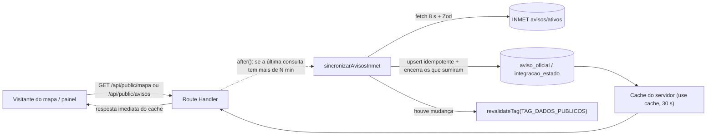

# Plano de Integração — Defesa Civil e Órgãos de Monitoramento

> **Documento técnico de evolução pós-MVP (v2.0, revisado em 17/11/2026)**
> **Projeto:** WhereToGo — Plataforma de Gestão de Crise para Abrigos Emergenciais (Passo Fundo/RS, IBGE 4314100)
> **Mudança em relação à v1.1:** cada fonte foi conferida contra o endpoint real e a documentação oficial. A v1.1 tinha
> códigos COBRADE inexistentes, tratava avisos meteorológicos regionais como área de risco local e propunha um *poller*
> que não funciona no Next 16 nem no plano gratuito do Render. As correções estão marcadas com **(corrigido)**.

---

## 1. Decisões do responsável (17/11/2026)

| # | Pergunta | Decisão |
|---|---|---|
| 1 | Quais fontes externas agora? | **Só o INMET.** CEMADEN e ANA ficam documentadas e adiadas (dependem de credencial e de limiares oficiais). |
| 2 | Onde aparecem os avisos oficiais? | **No mapa público e no painel.** |
| 3 | Infraestrutura | A produção (Render) **continua no plano gratuito** (MVP). Logo, sem *worker* contínuo nem cron pago. |
| 4 | Papel `DEFESA_CIVIL` | **Entra no escopo**, mas ainda **não há contato** com a Defesa Civil de Passo Fundo. |
| 5 | Área de risco regional | **Só marca** `emAreaDeRisco` nos abrigos cobertos; **não** muda o `status_infraestrutura` do abrigo. |
| 6 | S2iD | Aceito o enquadramento **"subsídios para o FIDE"**, com **COBRADE por evento**. |
| 7 | CAP de saída | **Fora do escopo por enquanto**; requisitos documentados na seção 4.7. |

---

## 2. Panorama das fontes (conferido em 17/11/2026)

Não existe uma "API única da Defesa Civil". Cada órgão expõe (ou não) seus dados de um jeito.

| Fonte | O que existe de verdade | Acesso | Cobertura em Passo Fundo | Decisão |
|---|---|---|---|---|
| **INMET — Avisos** | `GET https://apiprevmet3.inmet.gov.br/avisos/ativos` (JSON `{hoje, futuro}`) e RSS com um CAP 1.2 por aviso (`/avisos/rss`, `/avisos/rss/{id}`) | Público, sem chave. Sem gzip, ETag ou CORS (~550 KB) | Sim: campo `geocodes` lista os municípios (4 de 6 avisos ativos incluíam 4314100 no dia da análise) | **Etapa 1 (implementar)** |
| **CEMADEN — PED** | API REST documentada (`sws.cemaden.gov.br/PED/api/ui/swagger.json`): `pcds-dados-recentes`, `acumulados-recentes`, `pcds-cadastro/estacoes` | Token obrigatório (SGAA, e-mail e senha cadastrados). Termos e limites não publicados | 5 pluviômetros, mas só 1 em dia; 2 parados desde mai/jul 2026 | **Adiada** (credencial) |
| **ANA — Telemetria** | Serviço legado `telemetriaws1.ana.gov.br/ServiceANA.asmx` (sem chave) e HidroWebService (identificador e senha, pedido por e-mail) | Legado aberto; novo com credencial | Estação **73371000 "PASSO FUNDO"** (Rio Passo Fundo, operada pela Defesa Civil RS, dado a cada 5 min) | **Adiada**: a API não tem cota de alerta nem de inundação |
| **IDAP / Defesa Civil Alerta** | Portaria MIDR 2.458/2026: alertas salvos em CAP e "públicos para consulta", mas **sem feed documentado** | Emissão restrita a órgãos cadastrados | Seria a fonte municipal ideal | **Monitorar** |
| **S2iD / FIDE** | Sem API de escrita (portal restrito a gestores) | — | — | **Etapa 4** (exportação de subsídios) |

### 2.1 Detalhes que a v1.1 errou (corrigido)
- O CAP do INMET **não traz `<geocode>` IBGE**: o filtro por município usa o campo `geocodes` do JSON.
- No JSON, o polígono já é GeoJSON (**lng, lat**). A inversão de ordem só vale para o `<polygon>` do XML CAP.
- `inicio`/`fim` do JSON vêm **sem fuso** (`"2026-11-17 09:00"`, hora de Brasília). O CAP do mesmo aviso usa `-03:00`. O Brasil não tem horário de verão desde 2019.
- Idempotência: o aviso tem `id_aviso` (estável) e `id_sequencia` (cresce a cada atualização, com `referencia` ao anterior). A chave é `id_aviso`.
- Severidades do INMET → CAP: "Perigo Potencial" (amarelo) = *Moderate*, "Perigo" (laranja) = *Severe*, "Grande Perigo" (vermelho) = *Extreme*.
- Os avisos são **macrorregionais**: cada polígono cobria de 387 a 4.216 municípios. **Não podem virar `AREA_RISCO`**. Isso marcaria todos os abrigos e todas as rotas da cidade como "em risco" em qualquer dia de tempestade, além de pintar o mapa inteiro.

---

## 3. Arquitetura (corrigido)

A v1.1 propunha um *poller* com `setInterval` iniciado em `scripts/start-prod.mjs`, chamando `revalidateTag`. Isso não funciona, por três motivos:
1. `start-prod.mjs` é ESM puro executado **antes** do `server.js` e não consegue importar o código TypeScript de `src/` (que fica dentro do bundle do Next).
2. `revalidateTag` só pode ser chamado em Server Functions e Route Handlers (`node_modules/next/dist/docs/01-app/03-api-reference/04-functions/revalidateTag.md`), não num laço em segundo plano.
3. No plano gratuito do Render o serviço **desliga após 15 min sem tráfego**: um laço no processo para justamente quando ninguém está olhando.

**Modelo adotado: sincronização sob demanda.**



- **Gatilho:** toda leitura do mapa público (o navegador consulta a cada 30 s) ou do painel verifica, **em memória**, se está na hora de consultar o INMET (no máximo uma verificação no banco por minuto por instância). Se estiver, agenda a sincronização com `after()`. A resposta do visitante nunca espera o INMET.
- **Concorrência:** `pg_try_advisory_lock` garante uma sincronização por vez, mesmo com mais de uma instância.
- **Circuit breaker:** 3 falhas seguidas pausam a fonte por 15 min (estado em `integracao_estado`). O mapa segue com os últimos avisos válidos.
- **Invalidação:** `revalidateTag` dentro do `after()` de um Route Handler é executado pelo Next (`withExecuteRevalidates` em `server/after/after-context.js`). Sem isso, o perfil `mapaPublico` já revalidaria em 30 s.
- **Serviço acordando do sono:** o primeiro visitante vê os avisos salvos (os vencidos já são filtrados por `fim > now()`), e a próxima atualização do navegador traz os novos.
- **CSP e service worker:** sem mudança. O INMET é consultado só pelo servidor (nem tem CORS). Os avisos chegam ao navegador dentro do `/api/public/mapa` e vão para o localStorage junto com o resto, o que já cobre o modo offline.
- **Região do Render (Oregon, EUA):** a consulta ao INMET só foi testada a partir do Brasil. Se o INMET recusar IP estrangeiro, o *breaker* segura e o painel mostra a falha. **Validar no primeiro deploy.**

---

## 4. Frentes

### 4.1 Frente 1 — Avisos meteorológicos oficiais do INMET · **Etapa 1 (implementada)**

**Para que serve:** o cidadão e a coordenação veem no mesmo lugar os avisos oficiais que afetam Passo Fundo (ex.: "Tempestade · Perigo · até 23:59"), com riscos e instruções do INMET, sem sair do app.

**Banco (`db/migrations/0011_avisos_oficiais.sql`):**
- `aviso_oficial`:
  - `fonte`, `id_externo` (= `id_aviso`), `identificador_cap`, `sequencia`;
  - `evento`, `severidade` (`MODERADA` | `SEVERA` | `EXTREMA`), `rotulo_severidade` (texto original do INMET), `cor`;
  - `inicio`/`fim` `TIMESTAMPTZ`, `riscos`/`instrucoes` `TEXT[]`, `link`;
  - `recebido_em`, `atualizado_em`, `encerrado_em`;
  - `UNIQUE (fonte, id_externo)`.
- `integracao_estado`: `fonte`, `ultima_tentativa`, `ultimo_sucesso`, `falhas_consecutivas`, `pausada_ate`, `ultimo_erro`.
- **Não** altera `ocorrencia_infraestrutura`, os triggers nem `emAreaDeRisco` / `rotaCruzaAreaRisco`. O polígono não é guardado: o filtro é por município, e o polígono continental não serve ao mapa.

**Código:**

| Arquivo | Papel |
|---|---|
| `src/modules/integracoes/inmet.ts` | Leitura e normalização do JSON do INMET (Zod por item, fuso `-03:00`, severidade, filtro por IBGE, link `avisos.inmet.gov.br/{id}`). Funções puras, testadas sem rede. |
| `src/modules/integracoes/avisos.service.ts` | `sincronizarAvisosInmet()` (lock, *breaker*, upsert, encerramento), `listarAvisosVigentes()`, `obterEstadoIntegracao()`. |
| `src/modules/integracoes/avisos.agendamento.ts` | `agendarSincronizacaoAvisos()`: verificação em memória + `after()` + `revalidateTag`. |
| `src/modules/publico/publico.cache.ts` / `publico.mapa.ts` | Avisos em cache e campo `avisos` no `/api/public/mapa` (entra no ETag). |
| `src/app/api/public/avisos/route.ts` | Lista pública de avisos vigentes (JSON). |
| `src/app/api/integracoes/avisos/route.ts` | Painel: avisos + estado da consulta (ADMIN e COORDENADOR). |
| `src/app/api/integracoes/avisos/sincronizacao/route.ts` | "Consultar agora" (ADMIN e, desde a Etapa 2, DEFESA_CIVIL). |
| `src/components/mapa/avisos-oficiais.tsx` | Selo de aviso no topo do mapa e lista no painel de alertas. |
| `src/app/admin/dashboard/faixa-avisos.tsx` | Faixa de aviso no painel; estado da consulta e botão para quem pode forçar a consulta. |

**Variáveis (opcionais, em `src/lib/env.ts` e `.env.example`):**
```ini
INTEGRACAO_AVISOS_INMET=true          # false desliga a consulta (avisos já salvos continuam até vencer)
MUNICIPIO_CODIGO_IBGE=4314100         # Passo Fundo/RS
INTERVALO_AVISOS_MIN=10               # intervalo mínimo entre consultas ao INMET
INMET_AVISOS_URL=https://apiprevmet3.inmet.gov.br/avisos/ativos
```

**Pronto quando:**
- um aviso real do INMET para Passo Fundo aparece no mapa e no painel após a primeira visita e some quando vence ou é retirado;
- com o INMET fora do ar, o mapa funciona normalmente e o painel do ADMIN mostra a falha;
- no modo offline, avisos vencidos não aparecem;
- `emAreaDeRisco` não muda por causa de aviso regional.

### 4.2 Frente 2 — Papel `DEFESA_CIVIL` e ocorrências regionais · **Etapa 2 (implementada)**
- **Por quê:** a RN3 da RF09 deixou "alerta da defesa civil sem abrigo" fora do MVP por falta de perfil. Também evita dar `ADMIN` (PIX, usuários) a quem só precisa de visão tática da cidade.
- **Banco (`db/migrations/0012_papel_defesa_civil.sql`):**
  - papel `DEFESA_CIVIL` em `papel_usuario`;
  - `fn_validar_vinculo_usuario`: `ADMIN` e `DEFESA_CIVIL` sem abrigo; os demais, com abrigo (`WTG02`);
  - `ocorrencia_infraestrutura.id_abrigo` anulável **só** para ocorrências regionais: tipos `VIA_BLOQUEADA`, `AREA_RISCO`, `ALAGAMENTO`, `DESLIZAMENTO` e `OUTRO`, sempre com local (`ocorrencia_infraestrutura_regional_ck`). Falta de energia, água, comunicação e risco estrutural são da edificação e exigem abrigo;
  - `fn_atualizar_status_infraestrutura` pula `id_abrigo` nulo. Por decisão (item 5), área regional **não** muda o status dos abrigos: a marcação vem do `emAreaDeRisco` já existente (`ST_Covers`).
- **RBAC em duas camadas:**
  - **Matriz:** fica em `src/lib/auth/permissoes.ts`, módulo puro, para as telas também esconderem o que o papel não pode usar. `rbac.ts` reexporta e mantém `exigirPermissao`.
  - **Visão global:** `ehVisaoGlobal()` (ADMIN ou DEFESA_CIVIL) substituiu os `papel === "ADMIN"` de listagem de abrigos, auditoria e acesso a abrigo. `papelSemAbrigo()` é usado na criação de usuários e no bloqueio de login.
  - **Tela inicial:** `ROTA_INICIAL_POR_PAPEL.DEFESA_CIVIL = "/admin/ocorrencias"`.
  - **`proxy.ts`:** sem mudança, porque só restringe o VOLUNTARIO.
- **O que a Defesa Civil pode (decidido nesta etapa, a validar com um agente real):**
  - **Pode:**
    - ver o painel de qualquer abrigo;
    - registrar, moderar e resolver ocorrências de qualquer abrigo;
    - criar e encerrar ocorrências regionais (`ocorrencia:regional`, também do ADMIN);
    - transferir estoque e acolhidos entre abrigos;
    - ver o histórico de estoque e a auditoria de toda a rede;
    - forçar a consulta ao INMET.
  - **Não pode:**
    - lançar estoque, ajustar inventário ou mudar o pedido de doação;
    - fazer check-in, editar ou dar saída a acolhido (vê o CPF mascarado);
    - editar telefone, capacidade, fila de triagem ou cadastro do abrigo (PIX);
    - gerenciar catálogo ou contas.
- **Telas:**
  - Infraestrutura ganhou a aba **Município**, com lista e formulário de ocorrência regional sem "local do abrigo" e com local obrigatório. A Defesa Civil abre nela; coordenadores só consultam.
  - Estoque, Acolhidos e Visão geral mostram só os controles permitidos.
  - A antiga "Gestão" vira **Auditoria** para a Defesa Civil.
  - O ADMIN cria a conta da Defesa Civil em Gestão → Equipe (perfil "Defesa Civil", sem abrigo).
- **Público:**
  - `listarAlertasPublicos` usa `LEFT JOIN abrigo` e devolve `abrigo: null` nas regionais, com rótulo próprio ("Via interditada", sem "no abrigo").
  - No mapa, o alerta regional diz "Alerta regional (Defesa Civil)" e não tem "Ver abrigo".
- **Conta de demonstração:**
  - `defesacivil@wheretogo.local` (seed, com uma via interditada regional de exemplo).
  - Em produção, `scripts/start-prod.mjs` chama `garantirContasDeDemonstracao()` quando o banco já tem dados. Ela só cria as contas de demonstração que faltam, sem tocar nas existentes.
- **Testes:**
  - `tests/unit/regras.test.ts`: matriz da Defesa Civil, visão global e proxy.
  - `tests/integration/defesa-civil.test.ts`:
    - vínculo pelo trigger;
    - criação de conta;
    - visão global;
    - 403 em PIX, usuários e estoque;
    - ocorrência regional no mapa;
    - área regional marcando `emAreaDeRisco` sem mudar status;
    - CHECK do banco;
    - rota do abrigo sem alcançar a regional.
  - E2E em `tests/e2e/api.test.ts`.
- **Pendente:** sem contato com a Defesa Civil de Passo Fundo, as permissões acima são um desenho a validar com um agente real.

### 4.3 Frente 3 — Ganhos internos sem API externa · **Etapa 3 (planejada)**
1. **Corroboração comunitária na moderação:** para cada reporte pendente, contar relatos do mesmo tipo a até 300 m nas últimas 2 h (`ST_DWithin`) e ordenar a fila por isso ("3 relatos em 300 m"). Se o volume crescer, uma coluna `localizacao` gerada com GiST evita o `ST_MakePoint` linha a linha.
2. **`rotaBloqueada` nas sugestões de transferência** (`obterDashboard`): o mesmo `ST_Intersects` do mapa, só com ocorrências locais aprovadas (nunca avisos regionais). Rota cortada vai para o fim da lista, com aviso "trajeto direto cruza área de risco" (é aproximação em linha reta).
3. **Transferência de abrigados em lote** (`POST /api/abrigos/[id]/transferencias-lote`): uma transação, bloqueio dos dois abrigos em ordem de id (mesmo padrão de `transferirAbrigado`) e rollback total se faltar vaga.

### 4.4 Frente 4 — Subsídios para o FIDE (S2iD) e prestação de contas · **Etapa 4 (planejada)**
- **O que o WhereToGo pode afirmar (corrigido):** o FIDE (Portaria MDR 260/2022, consolidada com a 3.646/2022) pede, em danos humanos, mortos, feridos, enfermos, **desabrigados**, desalojados, desaparecidos e outros afetados. O sistema só conhece **desabrigados** (pessoas em abrigo público) e a **assistência humanitária** prestada. Por isso o relatório é "subsídio para o FIDE", não "FIDE pronto".
- **Conteúdo:**
  - desabrigados no período e no pico, contando cada pessoa uma vez mesmo se transferida (`transferencia_abrigado`);
  - faixas etárias, só para planejamento interno;
  - assistência humanitária (`SAIDA_CONSUMO` por item e unidade);
  - doações recebidas;
  - ocorrências por categoria de dano.
- **COBRADE por evento (corrigido):** o COBRADE classifica o **desastre** (um por decreto ou operação), não cada ocorrência. Falta de energia, de água, de comunicação e via bloqueada são **danos e prejuízos**, não tipos de desastre. Códigos conferidos na tabela COBRADE (anexo da IN MI 01/2012):

  | Evento | Código |
  |---|---|
  | Inundações | 1.2.1.0.0 |
  | Enxurradas | 1.2.2.0.0 |
  | Alagamentos | 1.2.3.0.0 |
  | Deslizamentos de solo e/ou rocha | 1.1.3.2.1 |
  | Tempestade local/convectiva — Tornados | 1.3.2.1.1 |
  | Tempestade de raios | 1.3.2.1.2 |
  | Granizo | 1.3.2.1.3 |
  | Chuvas intensas | 1.3.2.1.4 |
  | Vendaval | 1.3.2.1.5 |
  | Colapso de edificações (só se houver colapso) | 2.4.1.0.0 |

  **Removidos da v1.1:** 2.4.2.1.0, 2.4.2.2.0 e 2.4.2.3.0 **não existem** (2.4.2.0.0 é rompimento/colapso de barragens), e 2.5.1.0.0 é transporte rodoviário (acidente), não bloqueio de via. Conferir a versão vigente no site da Defesa Civil Nacional antes de uso oficial.
- **LGPD:** só agregados. Contagens abaixo de 5 numa faixa etária são suprimidas na exportação (abrigo pequeno identificaria a pessoa). Cada exportação grava `RELATORIO_S2ID_EXPORTADO` em `log_auditoria`.
- **Prestação de contas (TCE/CGU):** CSV de `movimentacao_estoque` e eventos críticos de `log_auditoria` no período. O hash SHA-256 do arquivo fica registrado em `log_auditoria` no momento da exportação; sem esse registro, o hash não prova nada.

### 4.5 Frente 5 — Pluviômetros do CEMADEN · **Adiada (credencial)**
- **Para seguir:** cadastro na PED (token via SGAA) e confirmação de termos de uso e limites com o CEMADEN.
- **Desenho:**
  - tabela `estacao_monitoramento` só com a **última leitura** (sem histórico);
  - selo na moderação ("pluviômetro Parque Farroupilha, 1,8 km: 62 mm em 24 h") apenas com leitura de **até 3 h**;
  - "sem leitura recente" quando a estação estiver parada.
- **Limiares:** alinhados às faixas do próprio INMET, para coerência com os avisos (ex.: "Perigo Potencial" = 20 a 30 mm/h ou até 50 mm/dia).
- **Não usar** o endpoint não documentado do Mapa Interativo (`resources.cemaden.gov.br/.../getJson2.php`): não tem contrato.
- A PED **não tem API de alertas**: os "alertas do CEMADEN" vão para o CENAD e as defesas civis.

### 4.6 Frente 6 — Nível do Rio Passo Fundo (ANA) · **Adiada (limiares)**
- Dados disponíveis: estação 73371000, `DadosHidrometeorologicos` a cada 5 min, sem chave (serviço legado). A API nova pede credencial; o manual oficial indica o e-mail hidro@ana.gov.br, a confirmar.
- **Falta o essencial:** cota de alerta e cota de inundação. Esses limiares vêm da Sala de Situação RS / SGB e não foram encontrados para esta estação. O valor de `Nivel` parece referenciado a uma cota altimétrica e precisa de calibração com o operador (Defesa Civil RS).
- Sem limiar oficial, **não** se gera alerta nem "evacuação preditiva" automaticamente. Quando houver: indicador no painel (nível e tendência em cm/h) e, no máximo, uma **sugestão** pendente de moderação.

### 4.7 Frente 7 — Feed CAP 1.2 de saída · **Fora do escopo (documentado)**
Requisitos, para quando entrar:
- **Formato (corrigido):**
  - um documento CAP contém **um** `<alert>`;
  - o feed é **Atom/RSS** com um item por alerta, apontando para o CAP individual (ex.: `/api/public/alertas/cap` lista e `/api/public/alertas/{id}/cap` entrega cada um);
  - feed ideal de até 100 KB (máximo 900 KB, regra do Google);
  - `Content-Type: application/cap+xml`.
- **Mapeamento:**
  - `CRITICO` → `Severe`, `ALERTA` → `Moderate` (a v1.1 usava `Extreme`/`Severe`, acima do que o próprio INMET usa);
  - `category`: `Geo` (deslizamento, área de risco), `Met` (alagamento), `Transport` (via bloqueada), `Infra` (energia, água, comunicação), `Other`;
  - `<area>` com `<polygon>` (pares `lat,lng`, anel fechado) ou `<circle>lat,lng 0.2</circle>`.
- **Conteúdo:** só ocorrências aprovadas; **nunca** `relator_nome`/`relator_contato`; escape XML rigoroso.
- **Expectativa realista (corrigido):** o Google Public Alerts aceita apenas órgãos de segurança pública ou provedores oficiais de alertas; no Brasil esse canal é a IDAP. O Waze exige parceria. Um feed do WhereToGo **não** será ingerido automaticamente por esses agregadores. Serve como demonstração de interoperabilidade e para sistemas que o assinarem por acordo.

### 4.8 IDAP / Defesa Civil Alerta · **Monitorar**
A Portaria MIDR 2.458/2026 diz que os alertas ficam em CAP "públicos para consulta", mas nenhum feed foi publicado. A IDAP saiu do ar em out/2025 após invasão e voltou com acesso restrito. Se o MIDR publicar um feed CAP, o leitor de avisos da Etapa 1 pode receber uma segunda fonte (`fonte = 'IDAP'`) sem mudar o modelo.

---

## 5. Requisitos não funcionais

- **Resiliência:**
  - timeout de 8 s;
  - *breaker* (3 falhas → 15 min de pausa);
  - item inválido do INMET é descartado sozinho, enquanto formato geral inválido conta como falha;
  - nenhuma requisição de cidadão espera fonte externa.
- **3G (RNF01):** o mapa recebe só evento, severidade, rótulo, cor, início, fim, riscos, instruções e link. Nada de polígono nem lista de municípios (o JSON bruto tem ~550 KB).
- **LGPD:** avisos oficiais não têm dado pessoal. Exportações (Etapa 4) só com agregados.
- **Atribuição:** o INMET permite reprodução citando a fonte. Todo aviso exibido mostra "INMET" e o link para o aviso original.
- **Fora do escopo, mas atenção:** o Postgres gratuito do Render expira 30 dias após a criação (com carência de 14 dias).

---

## 6. Etapas e testes

| Etapa | Escopo | Depende de | Situação |
|---|---|---|---|
| 0 | Validar o INMET a partir do Render; pedir credenciais PED/ANA e cotas da estação 73371000 | — | INMET: no primeiro deploy. Pedidos: quando houver contato institucional |
| **1** | **Avisos do INMET (Frente 1)** | — | **Implementada** |
| **2** | **Papel `DEFESA_CIVIL` e ocorrências regionais (4.2)** | — | **Implementada** |
| 3 | Corroboração, `rotaBloqueada`, transferência em lote (4.3) | — | Planejada |
| 4 | Subsídios FIDE e prestação de contas (4.4) | 2 (permissão `relatorio:s2id`) | Planejada |
| 5 | CEMADEN (4.5) | Credencial PED | Adiada |
| 6 | ANA (4.6) | Limiares oficiais | Adiada |
| — | CAP de saída (4.7) | Decisão futura | Fora do escopo |

**Testes da Etapa 1:**
- `tests/unit/inmet.test.ts`: leitura do JSON (fixture reduzida de um retorno real), fuso, severidade, filtro por IBGE, item inválido descartado, formato geral inválido rejeitado.
- `tests/integration/avisos.test.ts` (PostGIS real, `fetch` simulado):
  - inserção e idempotência;
  - atualização por nova sequência;
  - encerramento do aviso que sumiu do feed;
  - vencido fora da lista;
  - *breaker* após 3 falhas;
  - abrigo **não** fica `emAreaDeRisco` por causa de aviso.

---

## 7. Fontes
- INMET: https://apiprevmet3.inmet.gov.br/avisos/ativos · https://apiprevmet3.inmet.gov.br/avisos/rss
- CEMADEN PED: https://sws.cemaden.gov.br/PED/api/ui/swagger.json
- ANA: https://telemetriaws1.ana.gov.br/ServiceANA.asmx · manual SRDH: https://www.gov.br/ana/pt-br/assuntos/monitoramento-e-eventos-criticos/monitoramento-hidrologico/orientacoes-manuais/manuais/manual_srdh_publica.pdf
- Portaria MIDR 2.458/2026 (IDAP): https://www.lex.com.br/portaria-midr-no-2-458-de-30-de-julho-de-2026/
- IDAP com acesso restrito: https://tecnoblog.net/noticias/defesa-civil-alerta-e-religado-apos-ataque-hacker-mas-com-acesso-restrito/
- COBRADE: https://www.cetran.pr.gov.br/sites/cetran/arquivos_restritos/files/migrados/File/Leis/Codificacao_e_Classificacao_Brasileira_de_Desastres_COBRADE2.pdf
- Portaria MDR 260/2022 consolidada: https://defesacivil.rs.gov.br/upload/arquivos/202301/10135036-portaria-260-e-3646-consolidao.pdf
- Google Public Alerts: https://developers.google.com/public-alerts/guides/overview · https://developers.google.com/public-alerts/guides/cap-requirements/feed-formats
- Render (plano gratuito): https://render.com/docs/free
