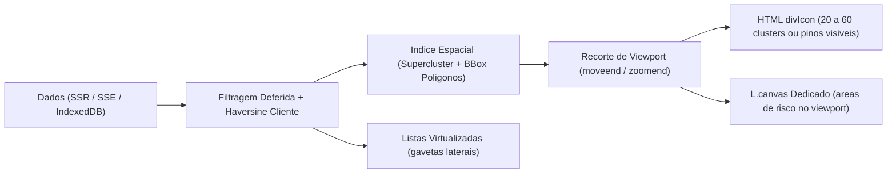

# Plano de Otimização de Interface — Mapa Público em Escala

> **Documento técnico de arquitetura e performance frontend (v1.0 — 25/11/2026)**
> **Projeto:** WhereToGo — Plataforma de Gestão de Crise para Abrigos Emergenciais
> **Referências:** [DESIGN.md](../DESIGN.md) (v2), [RF06](./tasks/RF06-mapa-interativo.md), [RF08](./tasks/RF08-roteamento-doacoes.md), [RF09](./tasks/RF09-alertas-risco.md) e [RNF](./tasks/RNF-requisitos-nao-funcionais.md)
> **Escopo:** Documento exclusivo de planejamento técnico para escalar a interface do mapa público (dezenas → centenas → milhares de itens). **Nenhuma fase descrita aqui foi implementada ainda.**

---

## 1. Contexto, Problema e Metas de Desempenho (SLOs)

No cenário atual de MVP municipal, o mapa público exibe dezenas de abrigos e algumas ocorrências ou áreas de risco. Caso o sistema escale para **centenas ou milhares de pontos, alertas e polígonos** (eventos climáticos severos, consórcios regionais ou operação estadual), a estratégia atual de manter cada item como um elemento DOM/SVG permanente e sincronizado de forma monolítica degrada até travar a interface:

1. **Saturação de DOM e layout:** cada pino e alerta cria múltiplos nós HTML/SVG que o Leaflet reposiciona a cada quadro de pan/zoom.
2. **Poluição visual e perda de clicabilidade:** centenas de pílulas de vagas se sobrepõem numa mesma região, impedindo o cidadão sob estresse de enxergar onde há vagas ou tocar no alvo desejado (*Thumb-First*).
3. **Bloqueio de interação em cadeia:** digitação na busca, rolagem das gavetas laterais, eventos SSE e gravações síncronas no `localStorage` disputam a mesma *main thread*.

### Metas de Desempenho (SLOs)

| Métrica | Linha de base (~2.000 itens hoje) | Meta pós-Fase 2 |
| :--- | :--- | :--- |
| Nós DOM ativos no container Leaflet (`.leaflet-pane`) | ~8.000 a 12.000 nós | **≤ 120 nós** (constante em relação ao tamanho da base) |
| Taxa de quadros em pan/zoom (celular intermediário) | Quedas severas / engasgos | **≥ 55–60 FPS** (*frame budget* ≤ 16,6 ms) |
| Latência de digitação na busca (INP) | > 150–300 ms por tecla | **≤ 50 ms** (input não bloqueado) |
| Tempo de filtragem + ordenação para 5.000 abrigos | ~40–120 ms (com clonagem e `localeCompare`) | **≤ 15 ms** |
| Orçamento de bundle adicional | — | Manter dentro do teto de **300 KB gzip** (`DESIGN.md` §1.7): Fase 1 **+0 a 3 KB**; Fase 2 **+~7 KB** (`supercluster` + `@tanstack/react-virtual`) |
| Persistência offline (5.000 itens) | Bloqueio síncrono da *main thread* e risco de estourar cota (~5 MB) do `localStorage` | **0 ms de bloqueio na *main thread*** via `IndexedDB` |

---

## 2. Diagnóstico da Arquitetura Atual (Linha de Base Verificada no Código)

A inspeção direta do código-fonte revela exatamente o que já funciona bem e onde estão os gargalos em escala:

| Camada / Componente | O que existe hoje no código | Ponto positivo / Gargalo em escala |
| :--- | :--- | :--- |
| **Marcadores de abrigos** `src/components/mapa-publico-leaflet.tsx` (L87–103, L140, L207–268) | `L.marker` com `L.divIcon` gerando 3–5 nós HTML por abrigo, controlado por `marcadoresRef` (`Map<number, { marcador, assinatura }>`). | **Bom:** `assinaturaDoPino` (L74–84) já aplica *diff* incremental e evita recriar pinos inalterados. **Gargalo:** 100% dos abrigos entram no `FeatureGroup` de uma vez, sem *clustering* nem *viewport culling*. Com 2.000 abrigos, o Leaflet transforma ~8.000 nós a cada zoom e os pinos se empilham. |
| **Alertas e áreas de risco** `src/components/mapa-publico-leaflet.tsx` (L61–62, L110–117, L160–167, L271–311) | `L.map(...)` sem `preferCanvas: true`: cada `L.polygon` vira um `<path>` SVG com `stroke-dasharray` e `.bindTooltip(texto, { sticky: true })`; alertas pontuais usam `L.divIcon` com `<svg>` inline (`SVG_ALERTA`, ~6 nós/alerta). | **Gargalo duplo:** (1) centenas de `<path>` SVG + tooltips `sticky` (`mousemove` contínuo) sobrecarregam CPU/GPU; (2) o efeito chama `grupoAlertas.clearLayers()` (L275) e **destrói e recria 100% das áreas e alertas** a cada atualização SSE/polling, mesmo quando apenas 1 abrigo mudou de lotação. |
| **Busca e filtragem** `src/components/mapa/cabecalho-mapa.tsx` (L55–65) e `filtrar-abrigos.ts` (L23–30, L77–95) | `<input type="search">` chama `onBuscar` (`setTermoBusca`) imediatamente a cada tecla. `filtrarAbrigos` clona todos os objetos (`.map(abrigo => ({ ...abrigo, ... }))`), chama `.toLowerCase()` repetidamente e ordena com `a.nome.localeCompare(b.nome, "pt-BR")`. | **Gargalo:** sem *debounce* nem `useDeferredValue`, cada caractere digitado recalcula, clona e reordena todo o catálogo (sem instância reutilizada de `Intl.Collator`) e dispara sincronização de marcadores no mapa na mesma prioridade do teclado. |
| **Gavetas e pilha de telas** `src/components/mapa/paineis-laterais.tsx` (L186–197, L229–256, L272–342) e `mapa-publico.tsx` (L464–553) | `ListaAbrigos` e `PainelAlertas` renderizam `abrigos.map(...)` e `alertas.map(...)` completos sem virtualização. A pilha de telas (`pilhaVisivel`) mantém telas abaixo montadas (`oculta` / `inert`). Em `PainelAlertas`, o formulário de reporte renderiza um `<select>` com todos os abrigos. | **Gargalo:** com 2.000 abrigos e 500 alertas, abrir a lista ou a ficha com lista na pilha sustenta dezenas de milhares de nós DOM vivos em segundo plano, além de gerar um `<select>` nativo impraticável no celular. |
| **Relógio de avisos e re-renders** `src/components/mapa/mapa-publico.tsx` (L153–160) | `setInterval(..., 60_000)` atualiza o estado `agora` em `TelaMapaPublico` para filtrar `avisosValidos`. `MapaPublicoLeaflet` não usa `React.memo`. | **Gargalo:** a cada 60 s, toda a árvore de `TelaMapaPublico` re-renderiza sem necessidade, propagando reconciliação até o componente do mapa e os painéis montados. |
| **Payload SSR, SSE, GPS e offline** `src/app/page.tsx` (L39), `use-dados-mapa.ts` (L64–70, L160–177), `publico.cache.ts` (L66–69), `publico.tempo-real.ts` (L271–294) | SSR serializa o snapshot completo no HTML (`JSON.parse(JSON.stringify(...))`); SSE (`abrirFluxoMapa`) reenvia todo o array `abrigos` + `alertas` a cada alteração; `salvarEstado` usa `localStorage.setItem` síncrono; informar GPS (`lat`/`lng`) pula o `"use cache"` e executa query PostGIS dedicada por conexão SSE. | **Gargalo:** `localStorage` bloqueia a *main thread* e falha acima de ~5 MB; snapshots completos saturam conexões 3G; queries individuais por posição GPS anulam o cache compartilhado em escala, apesar de `distanciaEmLinhaReta` (Haversine) já existir no cliente (`filtrar-abrigos.ts` L50–56). |
| **Camada base de tiles** `src/app/globals.css` (L225–231) | `.leaflet-tile-pane` aplica `filter: grayscale(1) invert(1) brightness(0.95) contrast(1.05)` (ou variante clara). | **Observação:** concentrar o filtro em um único pane é correto, mas combiná-lo com milhares de nós DOM e `<path>` SVG agrava o custo de composição em GPUs móveis fracas. |

---

## 3. Arquitetura Alvo (Renderização Híbrida e Fluxo de Dados)

A arquitetura alvo mantém o **Leaflet** e os **pinos em HTML** para preservar nitidez tipográfica, `tabular-nums`, acessibilidade nativa (`title`, leitores de tela) e o cache offline de tiles em `public/sw.js`, mas limita drasticamente o que vai para o DOM por meio de **indexação espacial**, **recorte de viewport** e **renderização híbrida (HTML + Canvas)**:

### Decisão Tecnológica: Leaflet Híbrido vs. MapLibre GL JS

| Cenário de Escala | Arquitetura Recomendada | Custo Adicional (gzip) | Compatibilidade com `sw.js` e CSP (`next.config.ts`) | Veredito |
| :--- | :--- | :--- | :--- | :--- |
| **Até ~500 itens** | Leaflet atual + Fase 1 (diff incremental de alertas, `L.canvas()`, busca deferida, virtualização de listas) | **+0 a 3 KB** | 100% compatível sem ajustes em `sw.js` nem CSP | Suficiente, zero risco de regressão visual. |
| **500 a ~15.000 itens** | **Leaflet + `Supercluster` + `L.canvas()` dedicado + Viewport Culling + `IndexedDB`** | **+~7 KB** | Mantém tiles HOT em `CACHE_TILES` (`sw.js`), filtro `.leaflet-tile-pane` e CSP atual (`worker-src 'self'`) | **Ponto ideal do projeto:** respeita o teto de 300 KB gzip do `DESIGN.md` e resolve 95% dos cenários reais de crise. |
| **20.000+ feições simultâneas** | **MapLibre GL JS** (WebGL, clustering na GPU, *vector tiles* / PMTiles) | **+~220 KB** | Exige migrar o cache de tiles raster de `public/sw.js`, adaptar `style-src`/`img-src`/`worker-src` na CSP e reimplementar o mapa base neutro | Só adotar mediante gatilhos objetivos da Fase 3 (§4.3.5). |

---

## 4. Especificação Detalhada por Fase

### 4.1 Fase 1 — Higiene de Performance e Renderização Cirúrgica (até ~500 itens | +0 a 3 KB gzip)

Foco em eliminar trabalho redundante de DOM, SVG e React sem alterar o visual atual dos pinos nem introduzir clustering.

#### 4.1.1 Diff incremental de alertas e tooltips sob demanda (`src/components/mapa-publico-leaflet.tsx`)
- Substituir `grupoAlertas.clearLayers()` (L275) por um mapa persistente `camadasAlertasRef = useRef<Map<number, { camada: L.Layer; assinatura: string }>>(new Map())`, espelhando o padrão já adotado em `marcadoresRef` para abrigos.
- Definir `assinaturaDoAlerta(alerta)` cobrindo: `tipo`, `gravidade`, `descricao`, `latitude`, `longitude`, `localizacaoPropria`, `abrigo?.id`, `abrigo?.nome` e resumo estrutural de `poligono` (comprimento + coordenadas dos vértices). Só atualizar ou recriar a camada quando a assinatura mudar; remover apenas os IDs ausentes ou quando `mostrarAlertas === false`.
- **Tooltips *lazy*:** remover a criação antecipada de `.bindTooltip(texto, { sticky: true })` para cada polígono e ponto no loop de renderização. Instanciar apenas um `L.tooltip` compartilhado (ou vincular o tooltip sob demanda no primeiro evento `mouseover` / `click`), eliminando centenas de instâncias de `L.Tooltip` e listeners `mousemove` inativos.
- Em `src/components/mapa/use-dados-mapa.ts`, evitar substituir a referência de `alertas` quando os dados de alerta recebidos no polling/SSE forem equivalentes ao estado atual (sub-assinatura separada de `abrigos`).

#### 4.1.2 Renderer `L.canvas()` dedicado para áreas de risco (`src/components/mapa-publico-leaflet.tsx`)
- Na inicialização do mapa (efeito 1), instanciar `const canvasAlertas = L.canvas({ padding: 0.5 })` em `canvasAlertasRef` (exclusivo para polígonos de risco, preservando marcadores de abrigo e alertas pontuais em HTML).
- Ao criar cada `L.polygon`, passar `{ renderer: canvasAlertasRef.current, smoothFactor: ... }` com `fillOpacity: 0.12`, `weight: 1.5` e `dashArray: "5 4"`.
- **Integração obrigatória com tokens e ESLint (`eslint.config.mjs`):** como o Canvas não lê classes CSS (`.wtg-area--critico`), criar um helper `lerCoresAreaCanvas()` que leia `getComputedStyle(document.documentElement)` para `--wtg-critico` e `--wtg-atencao`, sem declarar cores hex no TypeScript. Consumir `temaEfetivo` via `useTema()` (`src/components/ui/tema.tsx`) e chamar `layer.setStyle(...)` apenas quando `temaEfetivo` mudar.

#### 4.1.3 Busca deferida e `filtrarAbrigos` otimizado (`src/components/mapa/mapa-publico.tsx`, `filtrar-abrigos.ts`)
- Em `TelaMapaPublico` (`mapa-publico.tsx`), manter `termoBusca` síncrono no `<input>` do `CabecalhoMapa` e passar `useDeferredValue(termoBusca)` para `filtrarAbrigos`, garantindo que a digitação nunca aguarde reordenação ou atualização do Leaflet.
- Em `src/components/mapa/filtrar-abrigos.ts`:
  - Instanciar `const COLLATOR_PT_BR = new Intl.Collator("pt-BR")` uma única vez no escopo do módulo, substituindo `a.nome.localeCompare(b.nome, "pt-BR")` (L93).
  - Pré-normalizar a string de busca (`nome + endereco + urgentes` em minúsculas) usando um cache `WeakMap<AbrigoMapa, string>` interno ao módulo — sem alterar a assinatura pública de `AbrigoMapa` nem o payload da API.
  - Quando `categoriaSlug === null && itemFiltroId === null`, evitar o clone `.map((abrigo) => ({ ...abrigo, destaque: ... }))` (L82) caso `abrigo.destaque === null`, preservando a identidade referencial dos objetos e economizando alocações.

#### 4.1.4 Isolamento de re-render do mapa (`src/components/mapa/mapa-publico.tsx`, `mapa-publico-leaflet.tsx`)
- Exportar `MapaPublicoLeaflet` envolvido em `React.memo`.
- Extrair o relógio de 60 s (`agora` / `setInterval(..., 60_000)` hoje em `mapa-publico.tsx` L153–160) para um hook/subcomponente isolado responsável apenas pelo selo `SeloAvisoOficial` e pelo `PainelAlertas`, impedindo que a virada de minuto re-renderize `TelaMapaPublico` e `MapaPublicoLeaflet`.

#### 4.1.5 Virtualização das gavetas e seletor escalável no reporte (`src/components/mapa/paineis-laterais.tsx`)
- Integrar `@tanstack/react-virtual` (~3 KB gzip) em `ListaAbrigos` e na lista de ocorrências de `PainelAlertas`, mantendo no DOM apenas os itens visíveis (~12–15 linhas) mais `overscan: 5`, independente de haver 30 ou 5.000 resultados.
- Quando uma tela da pilha estiver oculta (`navegacao.oculta === true`), preservar o `scrollTop` da área rolável sem manter listas extensas no DOM.
- No formulário de reporte cidadão de `PainelAlertas` (L186–197), substituir o `<select>` com todos os abrigos por uma lista enxuta com: `"O mais próximo de você"` + os **5 abrigos mais próximos** da posição atual + campo rápido de filtragem por nome quando o usuário quiser escolher outro manualmente.

---

### 4.2 Fase 2 — Escalabilidade Visual e Estrutural (500 a ~15.000 itens | +~7 KB gzip)

Foco em manter o DOM do mapa constante (≤ 120 nós) e o *bundle* dentro do orçamento do `DESIGN.md`, organizando visualmente grandes volumes de dados sem perda de praticidade para quem busca vaga ou doação em situação de crise.

#### 4.2.1 Clustering Semântico + Viewport Culling com `Supercluster`
- **Dependência:** adicionar `supercluster` (~4 KB gzip).
- **Novo módulo puro:** `src/components/mapa/cluster-mapa.ts` (sem importação de `leaflet` nem acesso a DOM, permitindo testes unitários diretos em Node/Vitest).
- **Propriedades agregadas do cluster (`PropriedadesClusterAbrigo`):** via opções `map` e `reduce` nativas do `Supercluster`, cada agrupamento calcula em $O(\log N)$:
  - `qtdAbrigos: number`
  - `totalVagas: number` (soma de `Math.max(0, abrigo.ocupacao.vagasDisponiveis)`)
  - `qtdOk: number`, `qtdAtencao: number`, `qtdCritico: number`
  - `temDestaque: boolean` (`true` se ao menos 1 abrigo do grupo tem `destaque === true`)
  - `temAviso: boolean` (`true` se ao menos 1 abrigo do grupo tem `statusInfraestrutura !== "NORMAL"` ou `emAreaDeRisco`)
- **Regra semântica de cor do cluster (`DESIGN.md` §2.1):**
  - `ok` (verde `--wtg-ok`): `totalVagas > 0 && qtdOk > 0`;
  - `atencao` (âmbar `--wtg-atencao`): `totalVagas > 0 && qtdOk === 0`;
  - `critico` (vermelho `--wtg-critico`): `totalVagas === 0`.
- **Visual do cluster em `src/app/globals.css`:**
  - Classes `.wtg-cluster`, `.wtg-cluster--ok`, `.wtg-cluster--atencao`, `.wtg-cluster--critico`, `.wtg-cluster--apagado`, `.wtg-cluster__vagas`, `.wtg-cluster__qtd` e `.wtg-cluster__aviso`.
  - Mostrar em destaque o **total de vagas livres** (ex.: `142`) e, ao lado em peso secundário, a contagem de locais (ex.: `×8`), ambos com `tabular-nums`, borda `--wtg-fundo` e uso exclusivo dos tokens `--wtg-*`. Sem hex fixo e mantendo contraste WCAG ≥ 4.5:1 nos dois temas.
  - Atualizar a legenda `#legenda-mapa` em `src/components/mapa/barra-resumo.tsx` explicando o marcador agrupado em linguagem humana (*"Grupo de abrigos: soma de vagas e quantidade de locais; toque para aproximar"*).
- **Regras de interação UX (*Thumb-First*):**
  1. **Expansão em 1 toque:** clicar num cluster consulta `indice.getClusterExpansionZoom(clusterId)` e chama `voarAte(...)` compensando `areaCoberta` (painel aberto) e respeitando `prefers-reduced-motion`.
  2. **Pontos coincidentes no zoom máximo (sem *spiderfy*):** se o cluster atingir o zoom máximo configurado (`zoom >= MAX_ZOOM_CLUSTER`) ou se todas as suas folhas compartilharem a mesma coordenada, **não desenhar linhas radiais (*spiderfy*)** — difíceis de tocar no celular. Abrir a `ListaAbrigos` filtrada pelos `ids` daquele cluster (com cabeçalho indicando *"N abrigos neste ponto"* e botão *"Mostrar todos"*).
  3. **Proteção do abrigo selecionado:** o abrigo correspondente a `idSelecionado` **nunca** é ocultado dentro de um cluster enquanto selecionado; seu pino individual permanece visível com `zIndexOffset: 1000` e anel azul.
  4. **Filtro de doação:** quando houver filtro ativo (`categoriaSlug` ou `itemFiltroId`) e `ocultarNaoDestaque === false`, clusters onde `temDestaque === false` recebem `.wtg-cluster--apagado` (mesma opacidade de `.wtg-pino--apagado`), destacando imediatamente onde estão os locais prioritários.
- **Clustering de alertas pontuais:** instanciar um segundo índice `Supercluster` para alertas pontuais com `localizacaoPropria === true`, agregando `qtdAlertas` e a maior gravidade do grupo (`CRITICO` > `ALERTA`).
- **Viewport culling unificado:** nos eventos `moveend` e `zoomend` do Leaflet (agendados com `requestAnimationFrame`), consultar `getClusters([oeste, sul, leste, norte], zoom)` apenas para a área visível com margem de ~15% (`bounds.pad(0.15)`), mantendo entre 20 e 60 marcadores no DOM mesmo com 10.000+ registros em memória.

#### 4.2.2 Zoom Semântico (LOD) e Recorte por Bounding Box de Polígonos
Definir visibilidade e simplificação progressivas por faixa de zoom em `src/components/mapa-publico-leaflet.tsx`:

| Faixa de Zoom | Abrigos | Alertas Pontuais (`localizacaoPropria`) | Áreas de Risco (`L.polygon` em `L.canvas()`) |
| :--- | :--- | :--- | :--- |
| **`z ≤ 10` (visão regional / estadual)** | Clusters agregados por região com total de vagas | Ocultos ou condensados em clusters regionais para evitar ruído visual | Desenhados com `smoothFactor: 2.5` (apenas os com área significativa ou dentro da BBox visível) |
| **`z 11–13` (visão municipal / bairros)** | Clusters médios + pinos isolados | Clusters de alertas por proximidade | Desenhados no Canvas com `smoothFactor: 1.5` e culling por BBox |
| **`z ≥ 14` (ruas e quadras)** | Pinos individuais de vagas | Pinos individuais de alerta com ícone e tooltip *lazy* | Desenhados com precisão completa (`smoothFactor: 1.0`) e culling por BBox |

- **Culling de polígonos por Bounding Box:** ao receber `alertas`, pré-calcular `[sul, oeste, norte, leste]` de cada polígono uma única vez (`Map` memoizado). Em `moveend`/`zoomend`, adicionar/manter no `canvasAlertas` somente os polígonos cuja BBox intersecta `mapa.getBounds().pad(0.25)`.

#### 4.2.3 Cálculo de Distância e Raio no Cliente (Cache Hit 100% no Servidor/CDN)
- Hoje, quando o cidadão ativa o GPS, `useDadosMapa` envia `lat` e `lng` para `/api/public/mapa` e `/api/public/mapa/eventos`, fazendo `listarAbrigosPublicosEmCache` (`src/modules/publico/publico.cache.ts` L66–69) e `abrirFluxoMapa` (`src/modules/publico/publico.tempo-real.ts` L275–276) desviarem do cache compartilhado para rodar queries PostGIS exclusivas por visitante.
- **Mudança:** calcular `distanciaKm` e aplicar o filtro `raioKm` diretamente no cliente usando `distanciaEmLinhaReta` (já existente em `src/components/mapa/filtrar-abrigos.ts` L50–56). Todas as consultas gerais do mapa passam a usar a **mesma URL sem coordenadas**, elevando o *cache hit* da CDN (`CACHE_PUBLICO`) e do `"use cache"` para ~100% mesmo sob milhares de acessos simultâneos com GPS ligado.
- **Preservação de `rotaCruzaAreaRisco`:** como o cálculo de linha reta usuário → abrigo cruzando área de risco dependia da query com `lat`/`lng`, mover essa verificação para:
  1. Cálculo geométrico local no cliente (interseção do segmento `[usuario, abrigo]` com as BBoxes/polígonos ativos já presentes em `alertas`) para a lista e alertas rápidos; e/ou
  2. Parâmetro opcional `?lat=...&lng=...` na consulta pontual `GET /api/public/abrigos/[id]` ao abrir a `FichaAbrigo`, preservando a exatidão PostGIS na tela de detalhe.

#### 4.2.4 Persistência Offline Assíncrona em `IndexedDB`
- **Novo módulo:** `src/components/mapa/armazenamento-offline.ts` (wrapper mínimo e sem dependências sobre a API nativa `indexedDB`, banco `wtg-mapa`, *object store* `estado`, chave `"ultimo-snapshot"`).
- Substituir `lerEstadoSalvo()` / `salvarEstado()` síncronos baseados em `localStorage` em `src/components/mapa/use-dados-mapa.ts` (L55–70, L176, L369–384) por chamadas assíncronas ao `IndexedDB`, com *debounce* de 1.000 ms (ou `requestIdleCallback` quando disponível) para evitar escritas repetidas durante rajadas de SSE.
- **Migração e fallback:** na primeira leitura, se o `IndexedDB` estiver vazio e existir `wtg:mapa:ultimo-estado` no `localStorage`, migrar uma única vez e remover a chave legada (`localStorage.removeItem`). Em navegadores/modos privados que bloqueiam `indexedDB`, falhar silenciosamente em memória sem quebrar o mapa.

---

### 4.3 Fase 3 — Escala Estadual / Multi-Município (15.000+ itens)

Fase reservada para quando a base crescer além do orçamento aceitável de payload único no SSR/SSE (ex.: cobertura estadual ou nacional com centenas de municípios simultâneos).

#### 4.3.1 Consulta Espacial por `bbox` + `zoom` no Backend
- Estender `esquemaFiltroMapa` (`src/modules/publico/publico.service.ts`), `obterMapaPublico` (`publico.mapa.ts`) e `/api/public/mapa` para aceitar `?bbox=oeste,sul,leste,norte&zoom=z` (além de filtro opcional por município/UF).
- Utilizar índice espacial GiST já existente (`a.localizacao` e `r.area_risco`) para retornar apenas as feições na região solicitada, aplicando `ST_SimplifyPreserveTopology` nos polígonos em zooms baixos e agregação por município/grade no servidor para `z ≤ 10`.
- Ajustar `MapaComDados` (`src/app/page.tsx`) para entregar no HTML inicial apenas o recorte da região padrão (ou agregados regionais + abrigos do município configurado em `MUNICIPIO_CODIGO_IBGE`).

#### 4.3.2 SSE por Deltas (Patches) em Tempo Real
- Evoluir `abrirFluxoMapa` (`src/modules/publico/publico.tempo-real.ts`) e `useDadosMapa` (`src/components/mapa/use-dados-mapa.ts`) para emitir deltas granulares após a sincronização inicial:
  - `abrigo:upsert` / `abrigo:remove`
  - `alerta:upsert` / `alerta:remove`
  - `avisos:sync`
- Cada patch carrega uma revisão sequencial monotônica; se o cliente detectar lacuna de sequência após reconexão, solicita re-sincronização via `GET /api/public/mapa`.

#### 4.3.3 Payload Enxuto para Listagem de Mapa
- Reduzir o tamanho JSON de cada item no `/api/public/mapa`:
  - Enviar apenas os `id`s de itens urgentes (`necessidades.urgentes`) em vez de repetir `{ id, nome, categoria }` em milhares de abrigos, resolvendo nomes e slugs no cliente pelo dicionário `categorias` já carregado.
  - Arredondar `latitude`/`longitude` de retorno para 5 casas decimais (~1,1 m de precisão, mais que suficiente para pinos de abrigo).
  - Manter `bloqueados`, descrições longas de ocorrências e dados de contato detalhados restritos ao endpoint sob demanda `GET /api/public/abrigos/[id]`.

#### 4.3.4 Web Worker Same-Origin para Indexação e Filtro Espacial
- Mover a construção do índice `Supercluster`, o filtro textual normalizado e o cálculo Haversine em massa para `src/workers/mapa-espacial.worker.ts`, mantendo a *main thread* dedicada apenas a renderização de UI e animações.
- **Requisito estrito de CSP:** carregar o Worker via URL *same-origin* (`new Worker(new URL("../workers/mapa-espacial.worker.ts", import.meta.url))`), compatível com `worker-src 'self'` em `next.config.ts` (L34), sem recorrer a `blob:` workers.

#### 4.3.5 Gatilho Objetivo para Migração para MapLibre GL JS (WebGL)
A troca de engine de Leaflet para **MapLibre GL JS** só deve ser iniciada se pelo menos um dos gatilhos abaixo for atingido:
1. Necessidade de exibir **> 20.000 feições pontuais simultâneas sem agrupamento** na tela.
2. Renderização frequente de **manchas de inundação ou bacias hidrográficas com dezenas de milhares de vértices** por polígono onde o `L.canvas()` não sustente ≥ 55 FPS após `ST_SimplifyPreserveTopology`.
3. Adoção obrigatória de *vector tiles* (`.pbf` / PMTiles) no mapa base com aceitação formal da revisão do orçamento de 300 KB gzip do `DESIGN.md` e da política de cache offline em `public/sw.js`.

---

## 5. Conformidade: Design System, Acessibilidade, CSP e Offline

| Aspecto | Requisito no Projeto | Como este plano garante conformidade |
| :--- | :--- | :--- |
| **Tokens e ESLint** | `eslint.config.mjs` (L7–22) proíbe paleta crua do Tailwind e hex fixo em `src/**/*.{ts,tsx}`. | Classes `.wtg-cluster*` usam apenas variáveis `--wtg-*` em `src/app/globals.css`. O renderer `L.canvas()` lê `--wtg-critico` e `--wtg-atencao` em runtime via `getComputedStyle`. |
| **Contraste WCAG** | Texto ≥ 4,5:1 nos temas claro e escuro (`DESIGN.md` §2.1 e §8.5). | Todo novo estilo de cluster passa pela validação de `scripts/contraste-wcag.js` nos modos claro, escuro e sistema. |
| **Acessibilidade (a11y)** | Leitores de tela, alvos de toque ≥ 48 × 48 px (`globals.css` L155–166) e `prefers-reduced-motion`. | Clusters exibem `title`/`alt` descritivo (*"Grupo com 8 abrigos e 142 vagas livres. Toque para aproximar."*). Expansão respeita `movimentoReduzido()` (`mapa-publico-leaflet.tsx` L33–35). Pontos coincidentes abrem `ListaAbrigos` navegável por teclado. |
| **Segurança / CSP** | `next.config.ts` (`POLITICA_DE_CONTEUDO`, L23–40). | Fases 1 e 2 não alteram nenhuma diretiva da CSP. Na Fase 3, o Web Worker é empacotado *same-origin* sob `worker-src 'self'` (sem `blob:`). |
| **Modo Offline (`sw.js`)** | `public/sw.js` mantém cache de `/`, `/_next/static/*`, `/logos/*` e `CACHE_TILES` (HOT). | Fases 1 e 2 preservam integralmente os tiles HOT e a estratégia de cache do `sw.js`, apenas trocando o armazenamento de dados de `localStorage` para `IndexedDB`. |

---

## 6. Plano de Testes, Stress Test e Critérios de Aceite

### 6.1 Benchmark Sintético de Carga
Criar gerador determinístico de cenários em memória/seed de teste com **100**, **1.000**, **5.000** e **10.000 abrigos** + **500 alertas/polígonos**, medindo antes e depois de cada fase:
1. **Contagem de nós DOM** dentro de `.leaflet-pane` após carga inicial, pan e zoom.
2. **Taxa de quadros (FPS) e *Long Tasks* (> 50 ms)** no Chrome DevTools Performance com *CPU throttling 4x* simulando celular intermediário.
3. **Responsividade da busca (INP)** ao digitar continuamente com 5.000 abrigos carregados.
4. **Uso de Heap JS** após 20 ciclos seguidos de atualização SSE simulada (verificando ausência de vazamento de instâncias `L.Tooltip` ou `L.Layer`).
5. **Tamanho do *bundle* client-side (`next build`)** garantindo permanência abaixo do orçamento de 300 KB gzip para a rota `/`.

### 6.2 Testes Automatizados Previstos

| Arquivo de Teste | Cobertura |
| :--- | :--- |
| `tests/unit/cluster-mapa.test.ts` | Agregação de `totalVagas`, `qtdAbrigos`, cor semântica (`ok` / `atencao` / `critico`), prioridade de `temDestaque`, proteção do `idSelecionado` fora do cluster e detecção de pontos coincidentes no zoom máximo. |
| `tests/unit/filtrar-abrigos.test.ts` | Normalização e cache de busca, ordenação estável com `Intl.Collator("pt-BR")`, cálculo de `distanciaKm` e filtragem por `raioKm` via `distanciaEmLinhaReta` equivalentes ao comportamento anterior do servidor. |
| `tests/unit/armazenamento-offline.test.ts` | Escrita com *debounce* em `IndexedDB`, migração única e limpeza da chave legada `wtg:mapa:ultimo-estado` no `localStorage`, e degradação graciosa quando `indexedDB` estiver indisponível. |

### 6.3 Critérios de Aceite ("Pronto quando")
- **Fase 1 concluída quando:**
  - Uma atualização SSE alterando 1 abrigo não recria marcadores de alerta nem polígonos (`clearLayers()` removido).
  - Áreas de risco renderizam em `<canvas>` único com troca instantânea de cor entre tema claro e escuro.
  - Digitar na busca com 2.000 abrigos em *CPU 4x* não trava o campo de texto e `ListaAbrigos` rola a 60 FPS com < 30 nós de linha no DOM.
  - O tick de 60 s dos avisos oficiais não dispara re-render de `MapaPublicoLeaflet`.
- **Fase 2 concluída quando:**
  - Com 5.000 abrigos e 500 alertas carregados, `.leaflet-pane` mantém **≤ 120 nós** ativos em qualquer nível de zoom.
  - Clusters mostram a soma real de vagas livres na cor correta do estado semântico, respeitam filtro de doações, expandem em 1 toque e abrem `ListaAbrigos` filtrada quando há pontos coincidentes.
  - Ativar GPS não gera miss de cache no `/api/public/mapa` nem dispara nova query PostGIS por usuário para a listagem do mapa.
  - O estado offline de 5.000 abrigos é salvo e restaurado via `IndexedDB` sem bloquear a *main thread*.
- **Fase 3 concluída quando:**
  - Cenários multi-município (15.000+ pontos) operam por `bbox` + `zoom` com deltas SSE e indexação em Web Worker *same-origin* sem violar a CSP.

---

## 7. Mapa Consolidado de Fases, Dependências e Arquivos

| Fase | Escopo | Pacotes npm (+gzip) | Arquivos criados / modificados | Risco | Status |
| :--- | :--- | :--- | :--- | :--- | :--- |
| **Fase 1** | Diff de alertas, tooltips *lazy*, `L.canvas()`, busca deferida, `Intl.Collator`, `React.memo`, virtualização de listas e seletor enxuto de reporte | `@tanstack/react-virtual` (+~3 KB) | `src/components/mapa-publico-leaflet.tsx`, `src/components/mapa/mapa-publico.tsx`, `src/components/mapa/filtrar-abrigos.ts`, `src/components/mapa/paineis-laterais.tsx`, `src/components/mapa/use-dados-mapa.ts` | Baixo | Pendente |
| **Fase 2** | Clustering semântico (`Supercluster`), viewport culling, zoom semântico (LOD), culling de polígonos por BBox, Haversine no cliente, persistência `IndexedDB` | `supercluster` (+~4 KB) | `src/components/mapa/cluster-mapa.ts` *(novo)*, `src/components/mapa/armazenamento-offline.ts` *(novo)*, `src/components/mapa-publico-leaflet.tsx`, `src/components/mapa/mapa-publico.tsx`, `src/components/mapa/barra-resumo.tsx`, `src/components/mapa/ficha-abrigo.tsx`, `src/components/mapa/use-dados-mapa.ts`, `src/app/globals.css`, `tests/unit/cluster-mapa.test.ts` *(novo)*, `tests/unit/filtrar-abrigos.test.ts` *(novo)*, `tests/unit/armazenamento-offline.test.ts` *(novo)* | Médio | Pendente |
| **Fase 3** | API paginada por `bbox` + `zoom`, SSE por deltas, payload enxuto e Web Worker *same-origin* | Nenhum (0 KB) | `src/workers/mapa-espacial.worker.ts` *(novo)*, `src/modules/publico/publico.service.ts`, `src/modules/publico/publico.mapa.ts`, `src/modules/publico/publico.tempo-real.ts`, `src/app/page.tsx`, `src/components/mapa/use-dados-mapa.ts` | Alto (mudança de contrato API/SSE) | Pendente |
