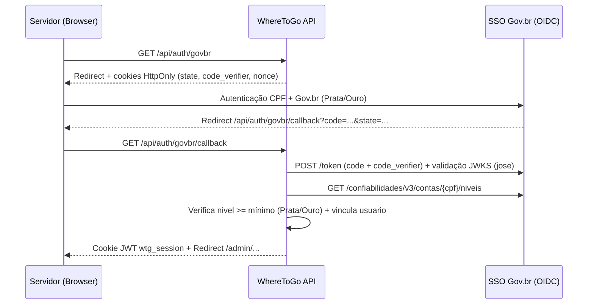
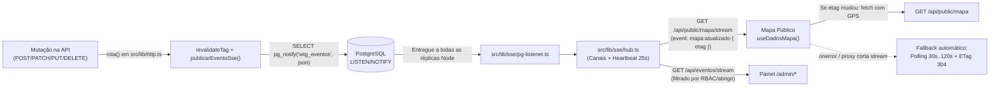
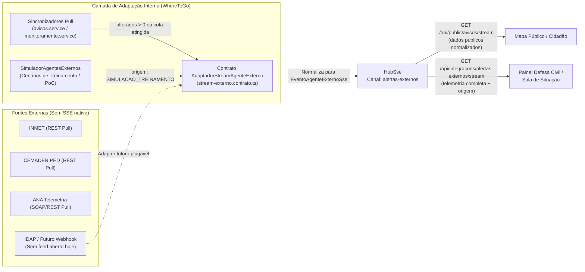

# Plano de Tarefas Pendentes — Evolução B2G (GovTech), Integrações e Tempo Real (SSE)

> **Documento técnico de backlog e arquitetura futura (v1.0 — 18/11/2026)**
> **Projeto:** WhereToGo — Plataforma de Gestão de Crise para Abrigos Emergenciais
> **Referência:** Continuação direta de [.specs/plano-integracao-defesa-civil.md](./plano-integracao-defesa-civil.md)
> **Escopo:** Documento exclusivo de planejamento para análise técnica e comercial. **Nenhuma tarefa descrita aqui foi implementada ainda.**

---

## 1. Contexto e Linha de Base Atual

As entregas do MVP (`v1.0.0`) e as **Etapas 1 a 4** do plano de integração com a Defesa Civil já compõem a base atual do sistema (até a migration `db/migrations/0013_eventos_desastre.sql`):

| Bloco já entregue | Artefatos principais no repositório | Situação |
|---|---|---|
| Core MVP (Abrigos, Estoque Fast-CRUD, Acolhidos, Mapa 3G, Auditoria, PostGIS) | `db/migrations/0001` a `0010`, `src/modules/*`, `src/components/mapa/*` | ✅ Implementado |
| Etapa 1 — Avisos Meteorológicos INMET | `db/migrations/0011_avisos_oficiais.sql`, `src/modules/integracoes/inmet.ts`, `avisos.service.ts` | ✅ Implementado |
| Etapa 2 — Papel `DEFESA_CIVIL` e ocorrências regionais | `db/migrations/0012_papel_defesa_civil.sql`, `src/lib/auth/permissoes.ts` | ✅ Implementado |
| Etapa 3 — Corroboração em 300 m, `rotaBloqueada` e transferência em lote | `src/modules/ocorrencias/ocorrencias.service.ts`, `abrigos.service.ts`, `abrigados.service.ts` | ✅ Implementado |
| Etapa 4 — Eventos COBRADE, Subsídios FIDE (S2iD) e Prestação de Contas SHA-256 | `db/migrations/0013_eventos_desastre.sql`, `src/modules/relatorios/fide.service.ts`, `prestacao-contas.service.ts` | ✅ Implementado |

Este plano organiza as **8 tarefas pendentes** em três blocos estratégicos para elevar o WhereToGo de uma plataforma municipal de MVP para uma solução B2G (GovTech) pronta para contratos com **Municípios, Consórcios Intermunicipais, Governos Estaduais (Defesa Civil / Casa Militar) e União (MIDR / SEDEC)**:

1. **Bloco I — Integrações Hidrometeorológicas e Interoperabilidade CAP** (Tarefas 1 a 3)
2. **Bloco II — Adequação B2G, Autenticação Gov.br, Multi-Município e SLA** (Tarefas 4 a 6)
3. **Bloco III — Arquitetura de Tempo Real via Server-Sent Events (SSE)** (Tarefas 7 e 8)

---

## 2. Bloco I — Integrações Hidrometeorológicas e Interoperabilidade CAP

### Tarefa 1 — Conector Pluviométrico CEMADEN (PED/SGAA) com Fallback Mock

- **Status:** Pendente *(adiada no plano anterior por dependência de credencial institucional SGAA)*
- **Objetivo:** Integrar leituras pluviométricas das PCDs (Plataformas de Coleta de Dados) do CEMADEN para enriquecer a fila de moderação de alagamentos e deslizamentos com precipitação real em 1 h e 24 h, prevendo **modo Mock de homologação** para demonstrações e Provas de Conceito (PoC) sem credencial ativa.

#### 1.1 Banco de Dados (`db/migrations/0014_monitoramento_cemaden_ana.sql`)

```sql
CREATE TABLE estacao_monitoramento (
    id                 INTEGER GENERATED ALWAYS AS IDENTITY PRIMARY KEY,
    fonte              VARCHAR(20)      NOT NULL,
    codigo_externo     VARCHAR(40)      NOT NULL,
    nome               VARCHAR(120)     NOT NULL,
    municipio_ibge     CHAR(7)          NOT NULL DEFAULT '4314100',
    latitude           DOUBLE PRECISION NOT NULL,
    longitude          DOUBLE PRECISION NOT NULL,
    localizacao        GEOGRAPHY(POINT, 4326) GENERATED ALWAYS AS (
                           ST_SetSRID(ST_MakePoint(longitude, latitude), 4326)::geography
                       ) STORED,
    -- Métricas pluviométricas (CEMADEN)
    acumulado_1h_mm    NUMERIC(6, 1),
    acumulado_24h_mm   NUMERIC(6, 1),
    -- Métricas hidrológicas (ANA — detalhadas na Tarefa 2)
    nivel_cm           INTEGER,
    vazao_m3s          NUMERIC(8, 2),
    tendencia_cm_h     NUMERIC(6, 1),
    cota_atencao_cm    INTEGER,
    cota_alerta_cm     INTEGER,
    cota_inundacao_cm  INTEGER,
    -- Classificação derivada (não gera evacuação automática)
    nivel_alerta       VARCHAR(15)      NOT NULL DEFAULT 'NORMAL',
    lido_em            TIMESTAMPTZ,
    atualizado_em      TIMESTAMPTZ      NOT NULL DEFAULT now(),
    CONSTRAINT estacao_monitoramento_externo_uk UNIQUE (fonte, codigo_externo),
    CONSTRAINT estacao_monitoramento_fonte_ck CHECK (fonte IN ('CEMADEN', 'ANA')),
    CONSTRAINT estacao_monitoramento_ibge_ck CHECK (municipio_ibge ~ '^[0-9]{7}$'),
    CONSTRAINT estacao_monitoramento_alerta_ck CHECK (nivel_alerta IN ('NORMAL', 'ATENCAO', 'ALERTA', 'ALTO_RISCO'))
);

CREATE INDEX estacao_monitoramento_localizacao_gix ON estacao_monitoramento USING GIST (localizacao);
CREATE INDEX estacao_monitoramento_municipio_ix ON estacao_monitoramento (municipio_ibge, fonte);

-- Expansão do circuit breaker existente para registrar falhas por fonte
ALTER TABLE integracao_estado
    DROP CONSTRAINT integracao_estado_fonte_ck,
    ADD CONSTRAINT integracao_estado_fonte_ck CHECK (fonte IN ('INMET', 'CEMADEN', 'ANA'));

INSERT INTO integracao_estado (fonte) VALUES ('CEMADEN'), ('ANA')
    ON CONFLICT (fonte) DO NOTHING;
```

#### 1.2 Arquitetura e Arquivos Previstos

| Arquivo | Responsabilidade |
|---|---|
| `src/modules/integracoes/cemaden.ts` | Cliente HTTP com timeout de 8 s, parser Zod dos endpoints REST `sws.cemaden.gov.br/PED/api` (`pcds-dados-recentes`, `acumulados-recentes`, `pcds-cadastro/estacoes`) usando token SGAA, mais provedor `CEMADEN_MODO=real\|mock` com fixture das 5 estações de Passo Fundo. |
| `src/modules/integracoes/monitoramento.service.ts` | Sincronização sob demanda com `pg_try_advisory_lock` + *circuit breaker* (3 falhas → pausa de 15 min em `integracao_estado`). Armazena apenas o estado atual por estação (sem série histórica pesada no banco operacional). |
| `src/modules/ocorrencias/ocorrencias.service.ts` | Em `listarOcorrencias`, cruza ocorrências pendentes de `ALAGAMENTO` e `DESLIZAMENTO` com a estação `CEMADEN` mais próxima via operador KNN `<->` do PostGIS, exibindo o selo apenas se `lido_em >= now() - interval '3 hours'` (ex.: *"Pluviômetro Parque Farroupilha (1,8 km): 62,4 mm em 24h"*; se parada, *"Sem leitura recente"*). |

#### 1.3 Limiares e Variáveis de Ambiente (`src/lib/env.ts`)

- **Limiares pluviométricos (alinhados à régua do INMET):**
  - `NORMAL`: `< 20 mm/h` e `< 30 mm/24h`
  - `ATENCAO` (Perigo Potencial): `20–29,9 mm/h` ou `30–49,9 mm/24h`
  - `ALERTA` (Perigo): `30–59,9 mm/h` ou `50–99,9 mm/24h`
  - `ALTO_RISCO` (Grande Perigo): `>= 60 mm/h` ou `>= 100 mm/24h`
- **Variáveis:** `INTEGRACAO_CEMADEN` (`true|false`), `CEMADEN_MODO` (`real|mock`), `CEMADEN_API_URL`, `CEMADEN_SGAA_TOKEN`, `INTERVALO_MONITORAMENTO_MIN` (padrão `10`).

#### 1.4 Critérios de Aceite e Testes

- `tests/unit/cemaden.test.ts`: validação Zod de payloads da PED, descarte de leitura sem timestamp válido e cálculo dos 4 níveis de alerta.
- `tests/integration/monitoramento.test.ts`: upsert idempotente em `estacao_monitoramento`, *circuit breaker* em `integracao_estado` e supressão de leitura com mais de 3 h na listagem de ocorrências.

---

### Tarefa 2 — Conector Hidrológico ANA (Telemetria) e Cotas Calibráveis

- **Status:** Pendente *(aguarda calibração de cotas oficiais junto à Sala de Situação RS / SGB; nasce com calibração manual pelo painel e modo Mock/Real)*
- **Objetivo:** Monitorar o nível e a vazão de rios (ex.: estação `73371000 — PASSO FUNDO`, dados a cada 5 min) no painel da Defesa Civil e do Administrador, permitindo calibrar localmente as cotas de atenção, alerta e inundação.

#### 2.1 Arquitetura e Arquivos Previstos

| Arquivo | Responsabilidade |
|---|---|
| `src/modules/integracoes/ana.ts` | Conector dual: suporte ao serviço legado aberto `telemetriaws1.ana.gov.br/ServiceANA.asmx` (`DadosHidrometeorologicos`) e à nova API `HidroWebService` (com identificador/senha), além de `ANA_MODO=real\|mock`. Calcula `tendencia_cm_h` comparando a leitura mais recente com a janela de 60 min anteriores no próprio retorno XML/JSON da API (sem exigir tabela histórica). |
| `src/modules/integracoes/monitoramento.service.ts` | `calibrarCotasEstacao(ctx, idEstacao, { cotaAtencaoCm, cotaAlertaCm, cotaInundacaoCm })` garantindo `atencao < alerta < inundacao` e registrando `ESTACAO_COTAS_CALIBRADAS` em `log_auditoria`. |
| `src/app/api/integracoes/monitoramento/route.ts` | `GET`: retorna estações CEMADEN + ANA e estado de sincronização (`aviso:ver` / `ADMIN`, `DEFESA_CIVIL`, `COORDENADOR`). |
| `src/app/api/integracoes/monitoramento/sincronizacao/route.ts` | `POST`: força consulta imediata (`aviso:sincronizar` / `ADMIN`, `DEFESA_CIVIL`). |
| `src/app/api/integracoes/monitoramento/estacoes/[id]/cotas/route.ts` | `PATCH`: atualiza cotas oficiais da estação (`monitoramento:calibrar` restrito a `ADMIN` e `DEFESA_CIVIL`). |
| `src/app/admin/ocorrencias/painel-hidrometeorologico.tsx` | Card tático exibindo cota atual, tendência (`+14 cm/h`), distância até a cota de inundação e aviso explícito quando as cotas ainda não foram calibradas. |

#### 2.2 Regra Crítica de Segurança Operacional

- **Nunca** emitir alerta público automático ou ordem de evacuação apenas com base em leitura telemétrica bruta.
- Se as cotas estiverem **não calibradas**, a API exibe apenas o valor numérico neutro (`nivel_alerta = 'NORMAL'`) sem cor de alarme.
- Se `nivel_cm >= cota_alerta_cm` com cotas calibradas, o sistema destaca o banner no painel da Defesa Civil e pode gerar no máximo uma **sugestão de ocorrência regional** (`ALAGAMENTO`, `status_moderacao = 'PENDENTE'`) para validação humana.

#### 2.3 Variáveis de Ambiente e Testes

- **Variáveis:** `INTEGRACAO_ANA`, `ANA_MODO` (`real|mock`), `ANA_ESTACOES` (lista CSV, padrão `"73371000"`), `ANA_CREDENCIAL_ID`, `ANA_CREDENCIAL_SENHA`.
- **Testes:** `tests/unit/ana.test.ts` (parsing XML/SOAP legado e JSON HidroWebService, cálculo de tendência cm/h) e ampliação de `tests/integration/monitoramento.test.ts` (RBAC da calibração de cotas e geração de sugestão pendente sem publicação automática no mapa).

---

### Tarefa 3 — Emissão de Feed Público CAP 1.2 (ITU-T X.1303 / Atom + XML)

- **Status:** Pendente *(Frente 7 documentada no plano de integração; sem migration necessária)*
- **Objetivo:** Expor ocorrências regionais e locais aprovadas em formato padrão internacional **CAP 1.2 (`Common Alerting Protocol`)** via feed Atom, habilitando interoperabilidade técnica com sistemas estaduais, Defesa Civil Nacional (IDAP) e agregadores parceiros.

#### 3.1 Contratos de Rotas e Regras do Padrão OASIS CAP 1.2

| Rota | Content-Type | Comportamento |
|---|---|---|
| `GET /api/public/alertas/cap` | `application/atom+xml; charset=utf-8` | Feed Atom listando ocorrências com `status_moderacao = 'APROVADO'` e `resolvida_em IS NULL`. Mantém limite rígido < 100 KB (paginação ou top 50 mais recentes) e `ETag`. |
| `GET /api/public/alertas/[id]/cap` | `application/cap+xml; charset=utf-8` | Documento XML CAP 1.2 individual (`<alert xmlns="urn:oasis:names:tc:emergency:cap:1.2">`). Retorna 404 se pendente, rejeitada ou já resolvida (para cancelamento, pode emitir `<msgType>Cancel</msgType>` durante janela configurável). |

#### 3.2 Regras de Mapeamento e LGPD (`src/modules/publico/publico.cap.ts`)

- **Severidade:** `CRITICO` → `<severity>Severe</severity>`; `ALERTA` → `<severity>Moderate</severity>` *(nunca inflar para `Extreme`, reservado a avisos meteorológicos extremos)*.
- **Categoria (`<category>`):**
  - `DESLIZAMENTO`, `AREA_RISCO` → `Geo`
  - `ALAGAMENTO` → `Met`
  - `VIA_BLOQUEADA` → `Transport`
  - `SEM_ENERGIA`, `SEM_AGUA`, `SEM_COMUNICACAO`, `RISCO_ESTRUTURAL` → `Infra`
  - `OUTRO` → `Other`
- **Geometria (`<area>`):**
  - Se houver polígono (`area_risco`), serializar `<polygon>` com pares **`lat,lng`** e anel fechado (primeiro e último ponto idênticos) — invertendo a ordem `lng,lat` do PostGIS/GeoJSON conforme especificação CAP 1.2.
  - Se houver apenas ponto (`latitude`, `longitude`), serializar `<circle>lat,lng 0.2</circle>` (raio de 200 m).
  - Incluir `<geocode><valueName>IBGE</valueName><value>4314100</value></geocode>`.
- **Segurança e LGPD:**
  - Escape XML rigoroso (`&`, `<`, `>`, `"`, `'`) em todos os campos textuais.
  - **Proibido** expor `relator_nome`, `relator_contato`, `id_usuario_registro` ou dados pessoais de abrigados.
- **Testes:** `tests/unit/cap.test.ts` (validação estrutural XML, inversão de coordenadas `lat,lng`, anel fechado, escape de caracteres maliciosos e ausência de dados de relatores).

---

## 3. Bloco II — Adequação B2G para Municípios, Consórcios, Estado e União

### Tarefa 4 — Autenticação Gov.br (OAuth2 / OpenID Connect + PKCE) e Níveis Prata/Ouro

- **Status:** Pendente *(diferencial decisivo em Pregões Eletrônicos, CPSI e contratos estaduais/federais)*
- **Objetivo:** Permitir que servidores públicos (`ADMIN`, `DEFESA_CIVIL`, `COORDENADOR`) autentiquem-se usando a identidade única **Login Único Gov.br**, com verificação opcional de selo de confiabilidade **Prata ou Ouro** e vinculação automática ao CPF/conta interna.

#### 4.1 Banco de Dados (`db/migrations/0015_auth_govbr.sql`)

```sql
ALTER TABLE usuario
    ADD COLUMN govbr_sub VARCHAR(128),
    ADD COLUMN govbr_nivel VARCHAR(10),
    ADD CONSTRAINT usuario_govbr_sub_uk UNIQUE (govbr_sub),
    ADD CONSTRAINT usuario_govbr_nivel_ck CHECK (govbr_nivel IS NULL OR govbr_nivel IN ('BRONZE', 'PRATA', 'OURO'));
```

#### 4.2 Fluxo OIDC + PKCE e Rotas



| Arquivo / Rota | Responsabilidade |
|---|---|
| `src/modules/auth/govbr.service.ts` | Geração de `state`/`nonce`/`PKCE` (`S256`), troca de código no endpoint `/token`, verificação JWS do `id_token` via JWKS (`jose`), consulta de selos (`BRONZE`/`PRATA`/`OURO`) e modo `GOVBR_MODO=real\|mock` (simula retorno OIDC em ambiente local/homologação sem credencial oficial do MGI). |
| `src/app/api/auth/govbr/route.ts` | Inicia o fluxo de autorização e grava cookies temporários `HttpOnly` (`SameSite=Lax`, TTL 5 min). |
| `src/app/api/auth/govbr/callback/route.ts` | Valida `state`, verifica nível mínimo (`GOVBR_EXIGIR_PRATA_OURO=true`), vincula conta existente por `govbr_sub`/e-mail ou cria solicitação pendente de aprovação (`ativo = false`), gravando auditoria `LOGIN_GOVBR_SUCESSO` ou `LOGIN_GOVBR_NIVEL_INSUFICIENTE`. |
| `src/app/login/page.tsx` | Botão oficial **"Entrar com gov.br"** seguindo o guia de identidade visual do Governo Federal, ao lado do login local e Google One Tap (mantido para voluntários civis). |

#### 4.3 Variáveis de Ambiente e Auditoria

- **Variáveis:** `GOVBR_ATIVO` (`false|true`), `GOVBR_MODO` (`real|mock`), `GOVBR_CLIENT_ID`, `GOVBR_CLIENT_SECRET`, `GOVBR_ISSUER_URL` (`https://sso.staging.acesso.gov.br` ou `https://sso.acesso.gov.br`), `GOVBR_REDIRECT_URI`, `GOVBR_EXIGIR_PRATA_OURO` (`true|false`).
- **Auditoria (`src/lib/auditoria.ts`):** Adicionar `LOGIN_GOVBR_SUCESSO`, `LOGIN_GOVBR_NIVEL_INSUFICIENTE`, `AUTO_CADASTRO_GOVBR`.
- **Testes:** `tests/unit/govbr.test.ts` (PKCE, validação de claims e regra de selo mínimo) e `tests/integration/auth-govbr.test.ts` (fluxo mock ponta a ponta, vinculação sem duplicar usuário e bloqueio de conta Bronze quando exigido Prata/Ouro).

---

### Tarefa 5 — Arquitetura Multi-Município / Multi-Tenant (Consórcios e Defesa Civil Estadual)

- **Status:** Pendente *(habilita contratos estaduais e consórcios intermunicipais com uma única instância gerenciada)*
- **Objetivo:** Eliminar a premissa atual de município único global (`MUNICIPIO_CODIGO_IBGE` em `src/lib/env.ts`), permitindo que uma mesma instância opere múltiplos municípios isolados por código IBGE e ofereça visão consolidada para **Consórcios Regionais** ou **Defesa Civil Estadual (Sala de Situação / CREPDEC)**.

#### 5.1 Banco de Dados (`db/migrations/0016_multi_municipio.sql`)

```sql
CREATE TABLE municipio (
    codigo_ibge   CHAR(7)          PRIMARY KEY,
    nome          VARCHAR(120)     NOT NULL,
    uf            CHAR(2)          NOT NULL DEFAULT 'RS',
    regional      VARCHAR(60),     -- ex.: "CREPDEC 7 - Planalto"
    latitude      DOUBLE PRECISION NOT NULL,
    longitude     DOUBLE PRECISION NOT NULL,
    zoom_inicial  SMALLINT         NOT NULL DEFAULT 13,
    ativo         BOOLEAN          NOT NULL DEFAULT TRUE,
    CONSTRAINT municipio_ibge_ck CHECK (codigo_ibge ~ '^[0-9]{7}$'),
    CONSTRAINT municipio_uf_ck   CHECK (uf ~ '^[A-Z]{2}$')
);

-- Seed retrocompatível com a operação atual
INSERT INTO municipio (codigo_ibge, nome, uf, latitude, longitude)
VALUES ('4314100', 'Passo Fundo', 'RS', -28.2628, -52.4067)
ON CONFLICT (codigo_ibge) DO NOTHING;

ALTER TABLE abrigo
    ADD COLUMN municipio_ibge CHAR(7) NOT NULL DEFAULT '4314100'
    REFERENCES municipio (codigo_ibge);

ALTER TABLE ocorrencia_infraestrutura
    ADD COLUMN municipio_ibge CHAR(7) NOT NULL DEFAULT '4314100'
    REFERENCES municipio (codigo_ibge);

ALTER TABLE evento_desastre
    ADD COLUMN municipio_ibge CHAR(7) NOT NULL DEFAULT '4314100'
    REFERENCES municipio (codigo_ibge);

-- Nulo apenas para gestores estaduais / admin global da plataforma
ALTER TABLE usuario
    ADD COLUMN municipio_ibge CHAR(7) REFERENCES municipio (codigo_ibge),
    ADD COLUMN escopo_territorial VARCHAR(15) NOT NULL DEFAULT 'MUNICIPAL',
    ADD CONSTRAINT usuario_escopo_ck CHECK (escopo_territorial IN ('MUNICIPAL', 'REGIONAL', 'ESTADUAL'));

-- Relação N:N entre aviso do INMET e municípios atendidos pela plataforma
CREATE TABLE aviso_oficial_municipio (
    id_aviso_oficial  INTEGER NOT NULL REFERENCES aviso_oficial (id) ON DELETE CASCADE,
    municipio_ibge    CHAR(7) NOT NULL REFERENCES municipio (codigo_ibge),
    PRIMARY KEY (id_aviso_oficial, municipio_ibge)
);

CREATE INDEX abrigo_municipio_ix ON abrigo (municipio_ibge) WHERE ativo = TRUE;
CREATE INDEX ocorrencia_municipio_ix ON ocorrencia_infraestrutura (municipio_ibge);
CREATE INDEX evento_desastre_municipio_ix ON evento_desastre (municipio_ibge);
```

#### 5.2 Impacto nas Camadas de Aplicação

- **RBAC (`src/lib/auth/permissoes.ts` e `rbac.ts`):**
  - Introduzir escopo territorial no `Contexto`: `ADMIN` e `DEFESA_CIVIL` com `escopo_territorial = 'MUNICIPAL'` só acessam dados do próprio `municipio_ibge`.
  - Novo papel (ou atributo de papel) `DEFESA_CIVIL_ESTADUAL` (`escopo_territorial = 'ESTADUAL' | 'REGIONAL'`) com visão consolidada multi-município para Sala de Situação e emissão de relatórios estaduais.
- **Rotas Públicas e Cache (`src/modules/publico/`):**
  - `GET /api/public/municipios`: lista municípios ativos para seletor do cidadão quando houver mais de 1 cadastrado.
  - `GET /api/public/mapa?municipio=4314100` (quando omitido, usa `env().MUNICIPIO_CODIGO_IBGE` como padrão).
  - Tag de cache por município (`dados-publicos:${codigoIbge}`) para que a movimentação de estoque em uma cidade não invalide o cache das outras 496 cidades de um contrato estadual.
- **Sincronização INMET (`src/modules/integracoes/avisos.service.ts`):**
  - Uma única descarga do JSON nacional (`apiprevmet3.inmet.gov.br/avisos/ativos`) passa a filtrar todos os `codigo_ibge` ativos da tabela `municipio`, gravando em `aviso_oficial` + `aviso_oficial_municipio`.
- **Relatórios FIDE (`src/modules/relatorios/fide.service.ts`):**
  - O relatório usa o `municipio_ibge` do `evento_desastre` selecionado (não mais apenas a variável de ambiente global).

---

### Tarefa 6 — Adequação de Infraestrutura B2G, Alta Disponibilidade (SLA) e Backups PITR

- **Status:** Pendente *(pré-requisito operacional para saída do tier gratuito do Render ao assinar contrato público)*
- **Objetivo:** Garantir continuidade operacional durante desastres climáticos (quando o tráfego multiplica e serviços gratuitos hibernam ou expiram em 30 dias) e atender exigências de auditoria e SLA em Termos de Referência públicos.

#### 6.1 Checklist Técnico de Produção B2G

1. **Topologia Web e Banco sem Hibernação:**
   - Migrar de instância única gratuita para **mínimo 2 réplicas web** atrás de balanceador HTTPS com *graceful shutdown*, `DB_POOL_MAX` dimensionado com PgBouncer/pooling em modo transacional (ou sessões dedicadas para `LISTEN/NOTIFY`).
   - Banco PostgreSQL 16 + PostGIS gerenciado com disco SSD dedicado e failover automático (Multi-AZ quando disponível).
2. **Política de Backups e Continuidade (RPO / RTO):**
   - **PITR (Point-in-Time Recovery):** arquivamento contínuo de WAL (`RPO <= 5 min`, `RTO <= 30 min`).
   - **Retenção Legal:** snapshots diários criptografados (AES-256) armazenados fora da região primária por no mínimo 365 dias (ou 5 anos quando exigido para prestação de contas de convênios).
3. **Observabilidade e `/api/health` Expandido (`src/app/api/health/route.ts`):**
   - Expor métricas não sensíveis para monitoramento externo (Uptime/Prometheus):
     - `banco.latenciaMs`, `banco.poolTotal`, `banco.poolOciosas`, `banco.poolEmEspera`;
     - `integracoes.{fonte}.ultimoSucesso`, `falhasConsecutivas`, `pausadaAte`;
     - `sse.clientesConectados`, `sse.pgListenerAtivo`.
   - Logs estruturados JSON no servidor com `requestId`, `rota`, `duracaoMs` e `status` (sem logar CPF, senha ou payload sensível — conformidade LGPD).

---

## 4. Bloco III — Arquitetura de Tempo Real via Server-Sent Events (SSE)

### Tarefa 7 — SSE na API Própria e no Mapa Público (com Fallback Automático para Polling 30 s)

- **Status:** Pendente *(alta prioridade para experiência em crise e redução de latência entre coordenação/voluntários e cidadãos)*
- **Motivação:**
  - Hoje, o mapa público (`src/components/mapa/use-dados-mapa.ts`) consulta `GET /api/public/mapa` em polling a cada `30 s` (com backoff até `120 s` e `If-None-Match`/`304`), e as telas internas (`/admin/*`) só refletem mudanças de outros operadores ao navegar ou recarregar.
  - Em cenários críticos (abrigo atingindo lotação máxima, interdição súbita de ponte, falta crítica de água/medicamento), o SSE entrega notificações em **< 1 segundo** mantendo uma única conexão HTTP unidirecional leve (compatível com HTTP/2, navegadores mobile e redes 3G), sem os custos de infraestrutura de um servidor WebSocket separado.

#### 7.1 Arquitetura Híbrida (`PostgreSQL LISTEN/NOTIFY` + Hub em Memória + Fallback Polling)



#### 7.2 Componentes de Backend Planejados

| Arquivo | Responsabilidade |
|---|---|
| `src/lib/sse/hub.ts` | Barramento central baseado em `ReadableStream` nativo da Web Streams API (compatível com Next.js 16 Route Handlers). Gerencia inscrições por canal (`mapa-publico`, `painel-admin`, `alertas-externos`), mantém contador de clientes conectados por IP (limite anti-abuso configurável, ex.: máx. 5 streams simultâneos por IP no público), envia comentário heartbeat `: ping <iso>\n\n` a cada `25 s` (impedindo timeout de proxies como Cloudflare/Render/Nginx) e limpa recursos no evento `req.signal.abort`. |
| `src/lib/sse/pg-listener.ts` | Conexão dedicada fora do pool transacional que executa `LISTEN wtg_eventos` apenas enquanto houver ao menos 1 cliente SSE conectado na instância (lazy connect). Se a conexão cair ou `SSE_PG_NOTIFY=false`, degrada graciosamente para emissão em memória local e agenda reconexão com backoff exponencial. |
| `src/lib/http.ts` | Estender `invalidarDadosPublicos(req, resposta)` (ou criar helper específico por domínio) para disparar `publicarEventoSse` após qualquer escrita bem-sucedida que altere abrigos, estoque, ocorrências, eventos ou avisos. |

#### 7.3 Endpoints SSE da API Própria

1. **Stream do Mapa Público — `GET /api/public/mapa/stream`**
   - **Acesso:** Público (`RNF02`), sujeito a `limitarPorIp` na abertura da conexão.
   - **Query params opcionais:** `municipio` (IBGE, padrão `4314100`), `etag` (última versão conhecida pelo cliente), `modo` (`leve` [padrão] | `completo`).
   - **Cabeçalhos obrigatórios:**
     - `Content-Type: text/event-stream; charset=utf-8`
     - `Cache-Control: no-cache, no-transform`
     - `Connection: keep-alive`
     - `X-Accel-Buffering: no`
   - **Eventos emitidos:**
     - `event: conectado` — enviado imediatamente ao abrir o stream:
       `{ "etag": "W/\"...\"", "municipioIbge": "4314100", "intervaloFallbackMs": 30000, "geradoEm": "..." }`
       *(Se o cliente enviou `Last-Event-ID` ou `?etag=` diferente do `etag` atual do cache, o servidor já envia imediatamente um evento `mapa:atualizado` para sincronizar delta perdido durante reconexão).*
     - `event: mapa:atualizado` — enviado quando qualquer escrita invalida `dados-publicos`:
       - No `modo=leve` (otimizado para **3G / RNF01**, ~150 bytes): `{ "etag": "W/\"...\"", "motivo": "abrigo|estoque|ocorrencia|aviso|catalogo", "municipioIbge": "4314100", "atualizadoEm": "..." }`.
       - No `modo=completo` (para painéis/telões sem GPS personalizado): inclui `{ abrigos, alertas, avisos }` no campo `dados`.
     - `event: alerta:critico` — enviado imediatamente quando uma ocorrência `CRITICO` ou aviso `EXTREMA` é aprovado/publicado:
       `{ "id": 42, "tipo": "VIA_BLOQUEADA", "gravidade": "CRITICO", "rotulo": "Via interditada", "abrigoId": null, "atualizadoEm": "..." }`.

2. **Stream Operacional Autenticado — `GET /api/eventos/stream`**
   - **Acesso:** Exige sessão JWT válida (`ADMIN`, `DEFESA_CIVIL`, `COORDENADOR`, `VOLUNTARIO`). Sem cookie válido retorna `401 NAO_AUTENTICADO` antes de abrir o stream.
   - **Filtragem por RBAC e Escopo no Servidor:**
     - `ADMIN` e `DEFESA_CIVIL`: recebem todos os eventos do seu escopo territorial (município ou estado).
     - `COORDENADOR` e `VOLUNTARIO`: recebem eventos globais relevantes (`aviso:oficial`, `ocorrencia:regional`) e **somente** eventos de estoque, lotação, triagem, ocorrências e transferências cujo `idAbrigo` coincida com o `ctx.usuario.idAbrigo`.
   - **Eventos emitidos:** `estoque:movimentado`, `abrigo:lotacao`, `ocorrencia:nova`, `ocorrencia:moderada`, `transferencia:lote`, `aviso:oficial`, `monitoramento:atualizado`.
   - **Privacidade (LGPD):** Eventos SSE **nunca** trafegam CPF, nome de abrigados ou dados de relatores — apenas IDs, contadores agregados e indicação de qual aba/lista deve revalidar.

#### 7.4 Evolução no Cliente do Mapa (`src/components/mapa/use-dados-mapa.ts`)

- **Comportamento planejado (retrocompatível):**
  1. Na montagem com aba visível (`document.visibilityState === "visible"`), o hook abre `new EventSource("/api/public/mapa/stream?etag=" + encodeURIComponent(etagAtual))`.
  2. Enquanto `eventSource.readyState === EventSource.OPEN`:
     - O timer de polling rápido (`30 s`) é pausado, mantendo apenas uma verificação de sanidade esporádica (`300 s` / 5 min) caso algum evento intermediário se perca.
     - Ao receber `mapa:atualizado`, compara `evento.etag !== versaoRef.current?.etag`; sendo diferente, chama `carregar()` imediatamente (preservando `lat`/`lng`/`raioKm` do GPS do usuário).
  3. **Fallback automático e resiliência 3G:**
     - Em caso de `onerror` (queda de rede, proxy que fecha conexão longa ou timeout de plataforma PaaS), fecha o `EventSource`, reativa imediatamente o loop de polling HTTP existente (`30 s → 120 s` com `If-None-Match` / `304`) e agenda reconexão SSE exponencial (`10 s → 30 s → 60 s`).
     - Se o navegador ficar offline (`window.offline`) ou a aba ficar oculta por > `60 s`, fecha o `EventSource` para economizar bateria e conexões no servidor; ao retornar (`online` / `visibilitychange`), reabre e força um `carregar()` com ETag.
- **Variáveis de Ambiente Previstas:** `SSE_ATIVO` (`true|false`), `SSE_PG_NOTIFY` (`true|false`), `SSE_HEARTBEAT_MS` (padrão `25000`), `SSE_MAX_CONEXOES_POR_IP` (padrão `5`).

#### 7.5 Testes Previstos

- `tests/unit/sse-hub.test.ts`: formatação de frames SSE (`id`, `event`, `data`, multiline), heartbeat, limpeza ao abortar `AbortSignal` e limite de conexões por IP.
- `tests/integration/sse-api.test.ts`: assinatura no stream `/api/public/mapa/stream`, disparo real de evento `mapa:atualizado` após `POST` em estoque/ocorrência, bloqueio `401` sem cookie no `/api/eventos/stream` e isolamento RBAC por `idAbrigo` para `COORDENADOR`/`VOLUNTARIO`.

---

### Tarefa 8 — SSE para Alertas de Agentes Exteriores (ANA, CEMADEN, INMET, IDAP) — Arquitetura Bridge & Simulador

- **Status:** Pendente *(especificação arquitetural e contrato de bridge/simulador — **sem implementação de conexão SSE real contra as APIs externas**)*

> [!IMPORTANT]
> **Restrição Real das APIs Governamentais (Verificado em 17–18/11/2026):**
> Nenhuma das fontes oficiais integradas ou mapeadas — **INMET** (`apiprevmet3.inmet.gov.br`), **CEMADEN PED** (`sws.cemaden.gov.br`), **ANA Telemetria** (`telemetriaws1.ana.gov.br`) e **IDAP / Defesa Civil Alerta** — oferece servidor **SSE**, **WebSocket** ou **Webhook push público** para terceiros. Todas operam exclusivamente por requisições **pull** (REST JSON ou SOAP/XML), ou ainda não disponibilizam feed público aberto (caso da IDAP).
> Portanto, esta tarefa **não** implementa clientes `EventSource` conectados a servidores externos. O objetivo é prover **uma camada de stream SSE dentro do WhereToGo** alimentada por um **Bridge Pull-to-SSE** (convertendo deltas reais capturados pelo sincronizador) e por um **Simulador de Alertas Externos** (para testes, treinamentos e PoCs).

#### 8.1 Arquitetura Bridge Interno + Simulador de Agentes Exteriores



#### 8.2 Contrato Canônico e Interface de Adaptação

- **Arquivo de Contrato Planejado:** `src/modules/integracoes/stream-externo.contrato.ts`
  - Define a interface `AdaptadorStreamAgenteExterno`:
    - `fonte: "INMET" | "CEMADEN" | "ANA" | "IDAP"`
    - `modo: "PULL_BRIDGE" | "SIMULADOR" | "PUSH_NATIVO_FUTURO"`
    - `iniciar(aoEmitir: (evento: EventoAgenteExternoSse) => void): Promise<void>`
    - `parar(): Promise<void>`
  - Garante que, caso o MIDR (IDAP) ou outro órgão federal disponibilize um feed push/SSE/Webhook no futuro, basta registrar uma nova implementação dessa interface sem modificar o `HubSse`, as rotas HTTP ou os componentes React.

- **Payload Canônico (`EventoAgenteExternoSse`):**

```json
{
  "idEventoStream": "ext-ana-73371000-20261118T140500Z",
  "fonte": "ANA",
  "origem": "SINCRONIZACAO_PULL",
  "tipo": "COTA_HIDROLOGICA",
  "severidade": "SEVERA",
  "municipioIbge": "4314100",
  "titulo": "Cota de Alerta Atingida — Rio Passo Fundo (Estação 73371000)",
  "resumo": "Nível observado em 420 cm (tendência +18 cm/h; cota de alerta: 400 cm).",
  "identificadorCap": null,
  "estacao": {
    "codigoExterno": "73371000",
    "nome": "PASSO FUNDO",
    "metrica": 420,
    "unidade": "cm"
  },
  "emitidoEm": "2026-11-18T11:05:00-03:00"
}
```

#### 8.3 Endpoints SSE e Simulador Controlado

1. **Stream Público de Avisos Externos — `GET /api/public/avisos/stream`**
   - Transmite apenas eventos com `origem !== "SIMULACAO_TREINAMENTO"` (ou seja, **nunca** vaza simulações de treinamento para o cidadão real no mapa público) e limitados a alertas oficiais consolidados (`INMET` e alertas públicos futuros de `IDAP`).
2. **Stream Tático de Agentes Exteriores — `GET /api/integracoes/alertas-externos/stream`**
   - **Acesso:** `ADMIN`, `DEFESA_CIVIL` e `COORDENADOR`.
   - Recebe o fluxo unificado de **INMET + CEMADEN + ANA + IDAP** (tanto `SINCRONIZACAO_PULL` quanto eventos de `SIMULACAO_TREINAMENTO`, estes sempre destacados com selo visual `"SIMULAÇÃO"` na UI).
3. **Disparador de Simulação Controlada — `POST /api/integracoes/alertas-externos/simulacao`** *(somente `ADMIN` e `DEFESA_CIVIL`, ativo apenas quando `STREAM_AGENTES_EXTERNOS_SIMULADOR=true`)*:
   - Permite disparar cenários pré-definidos de treinamento da Defesa Civil (ex.: `CHUVA_EXTREMA_CEMADEN`, `CHEIA_RIO_PASSO_FUNDO_ANA`, `AVISO_GRANDE_PERIGO_INMET`) injetando eventos `EventoAgenteExternoSse` no canal `alertas-externos` para testar o protocolo de resposta em bancas de PoC e simulados municipais, sem gravar avisos falsos como reais na tabela pública `aviso_oficial`.

#### 8.4 Modos de Configuração (`src/lib/env.ts`)

- `STREAM_AGENTES_EXTERNOS_MODO`: `"bridge"` *(padrão — converte deltas das consultas pull em SSE interno)* | `"simulador"` *(habilita cenários simulados em homologação/treinamento)* | `"desativado"`.
- `STREAM_AGENTES_EXTERNOS_SIMULADOR`: `"false"` *(padrão em produção para impedir acionamento acidental de cenários de teste)* | `"true"`.

#### 8.5 Testes Previstos

- `tests/unit/stream-externo.test.ts`: validação Zod de `EventoAgenteExternoSse`, conversão de delta INMET/CEMADEN/ANA para o envelope canônico e bloqueio estrito garantindo que eventos `SIMULACAO_TREINAMENTO` nunca sejam encaminhados ao canal público `/api/public/avisos/stream`.
- `tests/integration/sse-agentes-externos.test.ts`: disparo do bridge após `sincronizarAvisosInmet()` com mudança real no banco, verificação da entrega no stream autenticado `/api/integracoes/alertas-externos/stream` e validação de `403`/`404` quando `STREAM_AGENTES_EXTERNOS_SIMULADOR=false`.

---

## 5. Matriz Consolidada de Priorização, Dependências e Critérios de Aceite

| # | Tarefa Pendente | Migration | Dependência Externa / Institucional | Esforço Estimado | Principal Destravamento Comercial (B2G) | Suíte de Testes Exigida |
|---:|---|---|---|---|---|---|
| **1** | Conector CEMADEN (PED/SGAA) + Mock | `0014` | Token SGAA CEMADEN *(contornável em PoC via `CEMADEN_MODO=mock`)* | Médio | Enquadra o software em verba de monitoramento e prevenção | `cemaden.test.ts`, `monitoramento.test.ts` |
| **2** | Conector ANA (Telemetria) + Cotas Calibráveis | `0014` | Cotas oficiais da Sala de Situação RS / SGB *(para ativação de alarme)* | Médio | Diferencial técnico para municípios ribeirinhos e Estado (RS/SC) | `ana.test.ts`, `monitoramento.test.ts` |
| **3** | Feed Público CAP 1.2 (Atom + XML) | — | Nenhuma *(100% interno)* | Baixo | Prova de interoperabilidade ITU-T X.1303 em Termos de Referência | `cap.test.ts` |
| **4** | Login Único Gov.br (OIDC + PKCE) + Prata/Ouro | `0015` | Credencial Client ID no Portal Gov.br *(contornável em PoC via `mock`)* | Médio | Exigência recorrente em editais municipais, estaduais e federais | `govbr.test.ts`, `auth-govbr.test.ts` |
| **5** | Arquitetura Multi-Município / Multi-Tenant | `0016` | Nenhuma técnica *(necessária para venda multi-cidade)* | Alto | Habilita contratos com Consórcios Intermunicipais e Defesa Civil Estadual | `multi-municipio.test.ts`, regressão RBAC |
| **6** | Infraestrutura B2G (SLA, PITR, Observabilidade) | — | Contratação de nuvem dedicada (sair do free tier) | Baixo/Ops | Segurança contratual, RPO/RTO e conformidade TCE/CGU | Verificação `/api/health` + teste de carga |
| **7** | SSE na API Própria e Mapa Público (com fallback 30 s) | — | Nenhuma *(PostgreSQL `LISTEN/NOTIFY` já nativo)* | Médio/Alto | Atualização < 1 s em crise com resiliência garantida em 3G | `sse-hub.test.ts`, `sse-api.test.ts` |
| **8** | SSE de Agentes Exteriores (Bridge + Simulador) | — | Nenhuma técnica *(APIs externas não têm SSE nativo)* | Médio | Sala de Situação unificada + simulador de crise para treinamentos/PoC | `stream-externo.test.ts`, `sse-agentes-externos.test.ts` |

### Ordem Recomendada de Execução (Roadmap Pós-v1.0.0)

1. **Onda 1 — Valor imediato sem dependência de terceiros (1º Contrato Municipal):** Tarefa **3** (CAP 1.2) + Tarefa **7** (SSE API própria e mapa público) + Tarefa **8** (Bridge & Simulador SSE de agentes externos) + Tarefa **6** (adequação de infra no momento da implantação).
2. **Onda 2 — Diferenciais de Edital e Prova de Conceito (Pregão / CPSI):** Tarefa **1** (CEMADEN com mock/real) + Tarefa **2** (ANA com cotas calibráveis) + Tarefa **4** (Gov.br OIDC).
3. **Onda 3 — Escala Regional e Estadual:** Tarefa **5** (Multi-Município / Multi-Tenant).
