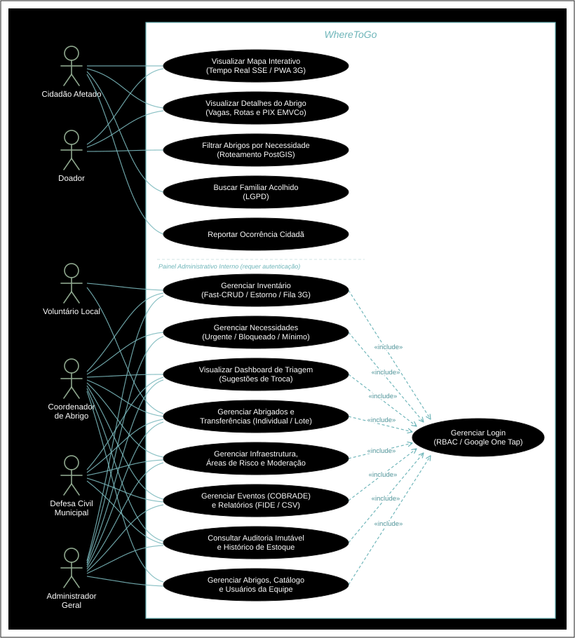
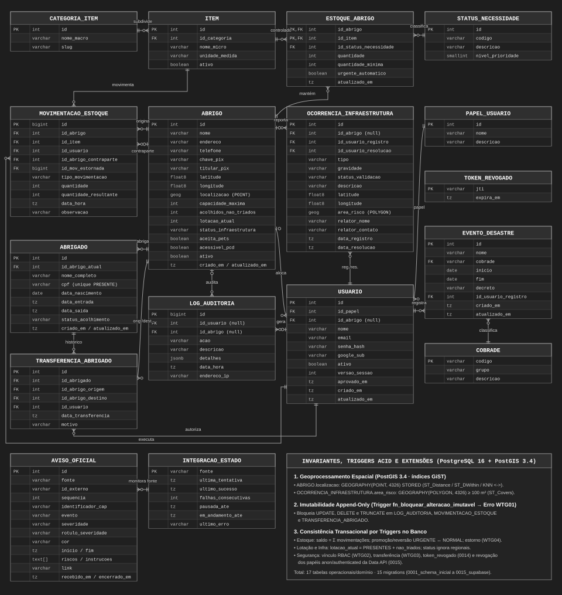

     
  <h3>Universidade de Passo Fundo – UPF</h3>
    
  <h1>DOCUMENTO DE VISÃO DO PRODUTO - DVP</h1>
  <h2>WhereToGo</h2>
     
  
<b>João Vitor de For dos Santos</b>

  
2026

     

---

**UNIVERSIDADE DE PASSO FUNDO – UPF** | **23/11/2026**
**Projeto WhereToGo Documento de Visão do Produto - DVP** | **Versão: 2.0**
*ADS/CCC/ECP – PROF. JEANGREI VEIGA /ALEXANDRE ZANATTA*

---

## Histórico de alterações do documento

| Versão | Alteração efetuada | Responsável | Data |
| :--- | :--- | :--- | :--- |
| 1.0.0 | Criação do escopo do projeto | João Vitor de For dos Santos | 01/09 |
| 1.1.0 | Elicitação dos requisitos | João Vitor de For dos Santos | 01/09 |
| 1.2.0 | Identificação do domínio e stakeholders | João Vitor de For dos Santos | 06/09 |
| 1.3.0 | Definição dos RF's e RNF's | João Vitor de For dos Santos | 07/09 |
| 1.4.0 | UML e Casos de Uso | João Vitor de For dos Santos | 07/09 |
| 1.5.0 | Definição da arquitetura, tecnologias e cronograma | João Vitor de For dos Santos | 07/09 |
| 2.0.0 | Atualização do DVP para refletir a implementação real do projeto (RF01–RF14, RNF01–RNF08, perfil Defesa Civil, UML, Casos de Uso, arquitetura Next.js 16 + SSE + INMET + FIDE/COBRADE, tecnologias e DER v2 revisado) | João Vitor de For dos Santos | 23/11 |

---

## Sumário

1. REQUISITOS
   1.1. Fundamentação dos Requisitos
      1.1.1. Técnicas Utilizadas para Requisitos
   1.2. Concepção dos Requisitos
      1.2.1. Identificação do Domínio
      1.2.2. Principais Stakeholders
   1.3. Elicitação dos Requisitos
      1.3.1. Requisitos Funcionais (RF)
         1.3.1.1. RF01 Gerenciar Acesso (Autenticação, Google One Tap e RBAC)
         1.3.1.2. RF02 Gerenciar Inventário de Suprimentos (Fast-CRUD e Catálogo)
         1.3.1.3. RF03 Gerenciar Status de Doações (Urgente/Normal/Bloqueado e Estoque Mínimo)
         1.3.1.4. RF04 Visualizar Dashboard de Triagem
         1.3.1.5. RF05 Reportar, Moderar e Gerenciar Ocorrências de Infraestrutura
         1.3.1.6. RF06 Visualizar Mapa Interativo de Abrigos em Tempo Real
         1.3.1.7. RF07 Visualizar Detalhes do Abrigo (Cards, Navegação e PIX)
         1.3.1.8. RF08 Roteamento de Doações (Filtro por Necessidade e Proximidade)
         1.3.1.9. RF09 Visualizar Alertas de Risco, Avisos Oficiais (INMET) e Reporte Cidadão
         1.3.1.10. RF10 Gerenciar Abrigos (Cadastro e Operação)
         1.3.1.11. RF11 Gerenciar Usuários da Equipe e Aprovações
         1.3.1.12. RF12 Gerenciar Abrigados, Transferências e Busca Pública de Familiares (LGPD)
         1.3.1.13. RF13 Consultar Auditoria Imutável e Histórico de Movimentações
         1.3.1.14. RF14 Gerenciar Eventos de Desastre (COBRADE) e Relatórios Oficiais (FIDE e Prestação de Contas)
      1.3.2. Requisitos Não-Funcionais (RNF)
   1.4. Especificação dos Requisitos
      1.4.1. UML – Diagrama de Casos de Uso
      1.4.2. Histórias de Usuário Por Caso de Uso
         1.4.2.1. UC01 Gerenciar Login
         1.4.2.2. UC02 Gerenciar Inventário (Fast-CRUD)
         1.4.2.3. UC03 Roteamento de Doações (Filtro por Necessidade)
         1.4.2.4. UC04 Gerenciar Abrigados, Transferências e Busca de Familiares
         1.4.2.5. UC05 Gerenciar Ocorrências, Áreas de Risco, Moderação e Avisos INMET
         1.4.2.6. UC06 Emitir Subsídios ao FIDE e Prestação de Contas
2. Projeto Técnico
   2.1. Arquitetura Utilizada
   2.2. Ferramentas e Tecnologias
   2.3. Modelo Lógico do Banco de Dados
3. Gestão de Projetos
   3.1. Cronograma de Codificação do Projeto

---

# 1. REQUISITOS

## 1.1. Fundamentação dos Requisitos

### 1.1.1. Técnicas Utilizadas para Requisitos

* **Análise de Domínio e Estudo de Caso Real:** levantamento das necessidades operacionais vivenciadas durante as enchentes no Rio Grande do Sul, alinhado às normas brasileiras de Defesa Civil, incluindo a codificação COBRADE (Anexo da IN MI 01/2012), os critérios de danos humanos e assistência humanitária do FIDE/S2iD (Portaria MDR 260/2022) e o protocolo CAP 1.2 dos avisos do INMET.
* **Benchmarking de Plataformas Humanitárias:** análise comparativa de soluções de resposta a desastres (como SOS RS, Ajuda RS, Ushahidi e Waze Crisis), incorporando tags de acessibilidade e acolhimento (Aceita Pets e Acessível PCD), busca pública de familiares acolhidos protegida pela LGPD e reporte cidadão com fila de moderação e corroboração espacial.
* **Prototipagem Evolutiva e Especificação Iterativa:** refinamento incremental em 8 semanas de desenvolvimento (MVP v1.0.0) e evolução pós-MVP em 4 etapas, evoluindo o modelo conceitual de dados (DER v1 de 5 tabelas para o DER v2 revisado com 17 tabelas e 15 migrations SQL versionadas).
* **Histórias de Usuário e Modelagem UML Orientada a RBAC:** especificação dos fluxos por casos de uso e regras de negócio segmentadas por perfil de acesso (`ADMIN`, `DEFESA_CIVIL`, `COORDENADOR`, `VOLUNTARIO` e acesso público), com critérios de aceite verificados por testes unitários, de integração com PostGIS real e E2E.

## 1.2. Concepção dos Requisitos

### 1.2.1. Identificação do Domínio

Em cenários de desastres naturais (como as enchentes no RS), a desinformação e a falta de coordenação logística agravam a crise. Sobreviventes têm dificuldade em encontrar abrigos com vagas, e doadores frequentemente entregam recursos em locais errados ou enviam itens que não são mais necessários, gerando desperdício e gargalos. Além disso, a gestão interna dos abrigos sofre com controles manuais lentos e falta de comunicação sobre riscos viários ou falta de infraestrutura básica (ex: energia).

**Solução Proposta:** Um sistema integrado de gestão de crise construído como aplicação full-stack unificada e dividido em duas frentes coordenadas. A primeira é uma **Aplicação Web Pública (PWA Mobile-First)** de acesso instantâneo sem login e otimizada para redes móveis degradadas (3G/Edge) e modo offline (Service Worker + `localStorage`), conectando cidadãos e doadores aos abrigos por meio de mapa interativo Leaflet.js (OSM HOT) com atualização em tempo real via Server-Sent Events (SSE) e fallback automático para polling com ETag, status de lotação, tags de perfil (Aceita Pets / PCD), roteamento inteligente de doações com PostGIS, chaves PIX oficiais com gerador nativo de QR Code e payload BR Code (EMVCo BACEN), busca pública de familiares acolhidos compatível com a LGPD, reporte cidadão moderado, demarcação poligonal de áreas de risco e exibição de avisos meteorológicos oficiais do INMET. A segunda frente é um **Painel Administrativo Interno** com controle de acesso baseado em papéis (**RBAC** em 4 perfis: Administrador Geral, Defesa Civil Municipal, Coordenador de Abrigo e Voluntário Local), oferecendo gestão de inventário tátil de resposta rápida (**Fast-CRUD** com fila offline em 3G, Lote Rápido e estorno em 1 toque), dashboard de triagem com sugestões de transferência entre abrigos e alerta de rota bloqueada por área de risco (`ST_Intersects`), gestão nominal de abrigados e transferências individuais ou em lote, moderação e reporte de ocorrências locais e regionais, gestão de eventos de desastre (COBRADE), emissão de subsídios ao FIDE (S2iD) e prestação de contas em CSV auditável (SHA-256), tudo amparado por livro-razão de movimentações e logs de auditoria imutáveis.

### 1.2.2. Principais Stakeholders

| STAKEHOLDER (Nome) | Responsabilidade | Contato |
| :--- | :--- | :--- |
| **Cidadão/Afetado** | Consome localização de abrigos ativos, lotação e vagas em tempo real, acessibilidade (Pets/PCD), rotas no Waze/Google Maps, alertas de risco, avisos oficiais do INMET, busca pública de familiares acolhidos (LGPD) e envia reportes cidadãos de incidentes no mapa público (sem login). | |
| **Doador (Público)** | Utiliza o mapa público para filtrar abrigos que necessitam urgentemente dos itens que possui para doar (ordenados por proximidade via PostGIS), evitando locais bloqueados por saturação, além de copiar chaves PIX oficiais ou escanear o QR Code BR Code gerado na ficha do abrigo. | |
| **Voluntário Local** | Acessa o Painel Interno (`VOLUNTARIO`, vinculado a um abrigo) para registrar entradas e saídas rápidas de suprimentos via interface tátil Fast-CRUD (incluindo Lote Rápido, fila offline 3G e estorno de toques recentes) e realizar o check-in nominal de abrigados. | |
| **Coordenador de Abrigo** | Gerencia o dashboard de triagem do seu abrigo (`COORDENADOR`), controla a fila de acolhidos não triados, ajusta capacidade/telefone, classifica necessidades (Urgente/Normal/Bloqueado e estoque mínimo), realiza ajustes e transferências de estoque/abrigados (individuais ou em lote), modera reportes cidadãos, gerencia ocorrências do abrigo e emite relatórios locais (FIDE/CSV). | |
| **Defesa Civil Municipal** | Possui visão tática global da rede (`DEFESA_CIVIL`, sem vínculo a abrigo único), cria e encerra ocorrências regionais no território (vias interditadas, áreas de risco em polígono, alagamentos, deslizamentos), modera ocorrências, coordena transferências de estoque e acolhidos entre abrigos, força sincronização do INMET, gerencia eventos COBRADE e consulta auditoria e relatórios globais. | |
| **Administrador Geral** | Tem visão sistêmica e controle completo da plataforma (`ADMIN`): cadastra e edita abrigos (incluindo localização e chave PIX oficial), gerencia o catálogo de categorias e itens, aprova auto-cadastros (Google One Tap) e gerencia usuários de todos os perfis, gerencia eventos COBRADE e audita integralmente os logs de segurança e movimentações. | |

---

## 1.3. Elicitação dos Requisitos

### 1.3.1. Requisitos Funcionais (RF)

#### 1.3.1.1. RF01 Gerenciar Acesso (Autenticação, Google One Tap e RBAC)
* **Importância:** [ x ] essencial [ ] importante [ ] desejável
* **Priorização:** [ x ] 1 [ ] 2 [ ] 3 [ ] 4 [ ] 5
* **Dependência com outro(s) requisito(s):** Nenhuma
* **Problema / Necessidades Identificadas:** O sistema deve permitir autenticação segura por e-mail/senha (`bcryptjs`) ou Google One Tap (com fluxo de solicitação de acesso e aprovação explícita), proteção de rotas em duas camadas (Edge Proxy + Services), revalidação do usuário no banco a cada requisição, troca de senha, revogação distribuída de tokens no logout e controle de acesso baseado em papéis (`ADMIN`, `DEFESA_CIVIL`, `COORDENADOR`, `VOLUNTARIO`).

#### 1.3.1.2. RF02 Gerenciar Inventário de Suprimentos (Fast-CRUD e Catálogo)
* **Importância:** [ x ] essencial [ ] importante [ ] desejável
* **Priorização:** [ x ] 1 [ ] 2 [ ] 3 [ ] 4 [ ] 5
* **Dependência com outro(s) requisito(s):** RF01
* **Problema / Necessidades Identificadas:** O sistema deve permitir a entrada e saída rápida de itens categorizados em catálogo hierárquico (categoria macro e item micro gerenciados pelo Administrador Geral) através de botões táteis de incremento/decremento (`+`/`-`), Lote Rápido sem teclado, estorno de movimentações recentes em 1 toque (`ESTORNO`), ajuste de contagem física (`AJUSTE`), transferência atômica entre abrigos e fila de sincronização offline para redes 3G instáveis, mantendo livro-razão transacional (`MOVIMENTACAO_ESTOQUE`).

#### 1.3.1.3. RF03 Gerenciar Status de Doações (Urgente/Normal/Bloqueado e Estoque Mínimo)
* **Importância:** [ x ] essencial [ ] importante [ ] desejável
* **Priorização:** [ x ] 1 [ ] 2 [ ] 3 [ ] 4 [ ] 5
* **Dependência com outro(s) requisito(s):** RF01, RF02
* **Problema / Necessidades Identificadas:** O sistema deve permitir ao Coordenador (do próprio abrigo) ou Administrador definir o status de necessidade de cada item (`URGENTE`, `NORMAL` ou `BLOQUEADO` por excesso) e sua quantidade mínima de segurança, promovendo automaticamente itens `NORMAL` para `URGENTE` quando o saldo cair abaixo do mínimo e revertendo essa promoção automática quando o estoque for reposto.

#### 1.3.1.4. RF04 Visualizar Dashboard de Triagem
* **Importância:** [ ] essencial [ x ] importante [ ] desejável
* **Priorização:** [ ] 1 [ x ] 2 [ ] 3 [ ] 4 [ ] 5
* **Dependência com outro(s) requisito(s):** RF01, RF02, RF12
* **Problema / Necessidades Identificadas:** O sistema deve exibir um painel operacional consolidado (para Coordenador, Defesa Civil e Administrador) com indicadores de lotação em tempo real (abrigados presentes + fila de acolhidos não triados), níveis visuais de saturação (verde < 70%, amarelo 70–90%, vermelho > 90%), alertas de estoque crítico, ocorrências ativas, avisos oficiais do INMET e sugestões automáticas de transferência de suprimentos entre abrigos (sinalizando quando a rota direta cruza área de risco ativa).

#### 1.3.1.5. RF05 Reportar, Moderar e Gerenciar Ocorrências de Infraestrutura
* **Importância:** [ ] essencial [ x ] importante [ ] desejável
* **Priorização:** [ ] 1 [ x ] 2 [ ] 3 [ ] 4 [ ] 5
* **Dependência com outro(s) requisito(s):** RF01
* **Problema / Necessidades Identificadas:** O sistema deve permitir registrar e resolver incidentes simultâneos no abrigo (`SEM_ENERGIA`, `SEM_AGUA`, `SEM_COMUNICACAO`, `VIA_BLOQUEADA`, `ALAGAMENTO`, `DESLIZAMENTO`, `RISCO_ESTRUTURAL`, `AREA_RISCO` por polígono PostGIS e `OUTRO`), bem como ocorrências regionais do município sem vínculo a abrigo (por `ADMIN` e `DEFESA_CIVIL`), além de moderar (aprovar/rejeitar) reportes enviados por cidadãos ordenados por corroboração espacial e temporal (300 m / 2 h).

#### 1.3.1.6. RF06 Visualizar Mapa Interativo de Abrigos em Tempo Real
* **Importância:** [ x ] essencial [ ] importante [ ] desejável
* **Priorização:** [ x ] 1 [ ] 2 [ ] 3 [ ] 4 [ ] 5
* **Dependência com outro(s) requisito(s):** Nenhuma
* **Problema / Necessidades Identificadas:** O sistema deve exibir um mapa público interativo (Leaflet.js + OpenStreetMap HOT) em formato JSON/GeoJSON com a localização de todos os abrigos ativos, marcadores coloridos por nível de ocupação, geolocalização do usuário ("perto de mim"), tags de acessibilidade (`aceitaPets`, `acessivelPcd`), atualização em tempo real via Server-Sent Events (SSE com fallback para polling + ETag) e modo offline resiliente com o último estado salvo.

#### 1.3.1.7. RF07 Visualizar Detalhes do Abrigo (Cards, Navegação e PIX)
* **Importância:** [ x ] essencial [ ] importante [ ] desejável
* **Priorização:** [ x ] 1 [ ] 2 [ ] 3 [ ] 4 [ ] 5
* **Dependência com outro(s) requisito(s):** RF06, RF03
* **Problema / Necessidades Identificadas:** O sistema deve exibir fichas detalhadas (bottom-sheet no mobile e painel lateral no desktop) ao selecionar um abrigo, apresentando ocupação e vagas disponíveis, endereço e telefone, selo de atualização recente, links de navegação direta para Google Maps (com origem GPS) e Waze, aviso de rota cruzando área de risco, chave PIX oficial com cópia rápida e QR Code BR Code (EMVCo BACEN CRC16-CCITT), lista de itens urgentes/bloqueados e ocorrências ativas.

#### 1.3.1.8. RF08 Roteamento de Doações (Filtro por Necessidade e Proximidade)
* **Importância:** [ ] essencial [ x ] importante [ ] desejável
* **Priorização:** [ ] 1 [ x ] 2 [ ] 3 [ ] 4 [ ] 5
* **Dependência com outro(s) requisito(s):** RF06, RF03
* **Problema / Necessidades Identificadas:** O sistema deve permitir que o doador selecione categorias (`slug`) ou itens específicos que possui para doar e, utilizando consultas espaciais PostGIS (`ST_Distance` e `ST_DWithin` com índice GiST), destaque e ordene por proximidade os abrigos ativos que necessitam urgentemente desses itens, ocultando ou reduzindo a ênfase dos demais e excluindo os que bloquearam doações daquele item.

#### 1.3.1.9. RF09 Visualizar Alertas de Risco, Avisos Oficiais (INMET) e Reporte Cidadão
* **Importância:** [ ] essencial [ x ] importante [ ] desejável
* **Priorização:** [ ] 1 [ x ] 2 [ ] 3 [ ] 4 [ ] 5
* **Dependência com outro(s) requisito(s):** RF06, RF05
* **Problema / Necessidades Identificadas:** O sistema deve exibir no mapa público as ocorrências pontuais aprovadas (locais e regionais da Defesa Civil), os polígonos de áreas de risco (`GEOGRAPHY(POLYGON, 4326)`) e os avisos meteorológicos oficiais do INMET vigentes para o município, além de permitir que cidadãos enviem reportes georreferenciados diretamente pelo mapa público para fila de moderação.

#### 1.3.1.10. RF10 Gerenciar Abrigos (Cadastro e Operação)
* **Importância:** [ x ] essencial [ ] importante [ ] desejável
* **Priorização:** [ x ] 1 [ ] 2 [ ] 3 [ ] 4 [ ] 5
* **Dependência com outro(s) requisito(s):** RF01
* **Problema / Necessidades Identificadas:** O sistema deve permitir que o Administrador Geral cadastre, edite (incluindo coordenadas no mapa, tags Pets/PCD e chave/titular PIX oficial) e desative abrigos vazios (`ativo = false`), e que o Coordenador atualize telefone, capacidade máxima (não inferior à lotação atual) e contador de acolhidos não triados do próprio abrigo.

#### 1.3.1.11. RF11 Gerenciar Usuários da Equipe e Aprovações
* **Importância:** [ x ] essencial [ ] importante [ ] desejável
* **Priorização:** [ x ] 1 [ ] 2 [ ] 3 [ ] 4 [ ] 5
* **Dependência com outro(s) requisito(s):** RF01, RF10
* **Problema / Necessidades Identificadas:** O sistema deve permitir que o Administrador Geral cadastre, edite, aprove solicitações pendentes (Google One Tap) e desative usuários de qualquer papel (`ADMIN`, `DEFESA_CIVIL`, `COORDENADOR`, `VOLUNTARIO`), e que o Coordenador gerencie voluntários vinculados exclusivamente ao seu próprio abrigo, preservando histórico e autoria sem exclusão física.

#### 1.3.1.12. RF12 Gerenciar Abrigados, Transferências e Busca Pública de Familiares (LGPD)
* **Importância:** [ ] essencial [ x ] importante [ ] desejável
* **Priorização:** [ ] 1 [ x ] 2 [ ] 3 [ ] 4 [ ] 5
* **Dependência com outro(s) requisito(s):** RF01, RF10
* **Problema / Necessidades Identificadas:** O sistema deve registrar o acolhimento nominal (check-in com conversão opcional da fila não triada, reentrada preservando estadias anteriores, validação de CPF e limite de capacidade), desligamento definitivo e transferências individuais ou em lote (1 a 200 pessoas, transação tudo-ou-nada) entre abrigos, atualizando automaticamente a lotação por triggers, além de oferecer busca pública "Encontre um Familiar" em conformidade com a LGPD (nome abreviado e CPF mascarado).

#### 1.3.1.13. RF13 Consultar Auditoria Imutável e Histórico de Movimentações
* **Importância:** [ ] essencial [ x ] importante [ ] desejável
* **Priorização:** [ ] 1 [ x ] 2 [ ] 3 [ ] 4 [ ] 5
* **Dependência com outro(s) requisito(s):** RF01, RF02
* **Problema / Necessidades Identificadas:** O sistema deve disponibilizar consulta paginada e filtrável (por usuário, abrigo, código de ação e período) dos logs imutáveis de auditoria (`LOG_AUDITORIA`) e do livro-razão de estoque (`MOVIMENTACAO_ESTOQUE`) para Administrador Geral, Defesa Civil (visão global) e Coordenador (próprio abrigo).

#### 1.3.1.14. RF14 Gerenciar Eventos de Desastre (COBRADE) e Relatórios Oficiais (FIDE e Prestação de Contas)
* **Importância:** [ ] essencial [ x ] importante [ ] desejável
* **Priorização:** [ ] 1 [ x ] 2 [ ] 3 [ ] 4 [ ] 5
* **Dependência com outro(s) requisito(s):** RF01, RF02, RF05, RF12, RF13
* **Problema / Necessidades Identificadas:** O sistema deve permitir o registro e encerramento de eventos de desastre classificados pela tabela oficial COBRADE (por `ADMIN` e `DEFESA_CIVIL`), a emissão em JSON e CSV de subsídios ao FIDE (S2iD) com contagem distinta de desabrigados, pico diário, faixas etárias com supressão LGPD (1 a 4 pessoas), assistência humanitária descontando estornos e ocorrências aprovadas, e a exportação de prestação de contas (TCE/CGU) em CSV com hash SHA-256 gravado em auditoria.

---

### 1.3.2. Requisitos Não-Funcionais (RNF)

| Identificação | Descrição |
| :--- | :--- |
| **RNF01 - Desempenho, Banda 3G e Offline (PWA)** | A Aplicação Web Pública deve abrir instantaneamente em redes móveis degradadas (3G/Edge) com dados iniciais embutidos no HTML, payload enxuto sem dados pessoais ou saldos de estoque, cache de CDN (`s-maxage=10`, `stale-while-revalidate`), fluxo em tempo real leve via SSE (`/api/public/mapa/eventos`) com fallback para polling `304 ETag`, Service Worker (`public/sw.js`) e persistência offline em `localStorage` com budget inicial compacto (< 300 KB). |
| **RNF02 - Segurança Pública e Acesso Sem Atrito** | A Aplicação Web Pública (`/`, `/api/public/*`, `/api/referencias`, `/api/health`) não deve exigir login ou cadastro para consulta de abrigos, rotas, PIX, avisos ou busca de familiares, protegida por limitadores de taxa por IP (10 reportes cidadãos / 15 min e 30 buscas de familiares / 5 min) contra abuso. |
| **RNF03 - Segurança, Imutabilidade e Auditoria** | Todas as alterações operacionais e eventos de segurança devem gerar registros append-only em `LOG_AUDITORIA` (ID do usuário, abrigo, código da ação, descrição, JSON de detalhes, timestamp e IP real), executados de forma assíncrona com `after()` do Next.js para não degradar o Fast-CRUD. Triggers de banco (`WTG01`) bloqueiam `UPDATE`, `DELETE` e `TRUNCATE` em `LOG_AUDITORIA`, `MOVIMENTACAO_ESTOQUE` e `TRANSFERENCIA_ABRIGADO`. |
| **RNF04 - Usabilidade Tátil, Tema e Acessibilidade** | O Painel Administrativo e o Mapa Público devem seguir design mobile-first com alvos de toque mínimos de 48×48 px (`min-h-12`), redução de digitação via Fast-CRUD (`+`/`-`, Lote Rápido e estorno em 1 toque), feedback tátil (`navigator.vibrate`), fila sequencial otimista com fila offline 3G, suporte a tema claro/escuro sincronizado e contraste validado via script WCAG (`scripts/contraste-wcag.js`). |
| **RNF05 - Arquitetura de Acesso (RBAC) e Hardening** | O Painel Interno implementa RBAC em 4 papéis (`ADMIN`, `DEFESA_CIVIL`, `COORDENADOR`, `VOLUNTARIO`) em duas camadas (Edge Proxy `src/proxy.ts` + matriz única `PERMISSOES` nos services), JWT HS256 (`jose`) em cookie `httpOnly`, revalidação do usuário no banco a cada requisição, revogação distribuída (`token_revogado` + `versao_sessao`), proteção anti-força-bruta no login e cabeçalhos CSP, HSTS, `X-Frame-Options` e `Permissions-Policy`. |
| **RNF06 - Privacidade e Conformidade com a LGPD** | Dados pessoais de abrigados (`nome_completo`, `cpf`, `data_nascimento`) jamais são expostos nas APIs de mapa ou cache em CDN; a busca pública de familiares utiliza cabeçalho `private, no-store`, abreviação de sobrenomes do meio e mascaramento de CPF; relatórios FIDE suprimem contagens de 1 a 4 pessoas por faixa etária; e a migration `0015` revoga privilégios dos papéis `anon`/`authenticated` da Data API do Supabase. |
| **RNF07 - Resiliência de Integrações e Multi-Instância** | A integração com o INMET opera sob demanda em background (`after()`), com timeout HTTP de 8 s, validação estrita via Zod por item, reserva atômica em banco (`integracao_estado.em_andamento_ate`) compatível com pooler em modo transacional (serverless) e *circuit breaker* persistente (3 falhas consecutivas pausam novas consultas por 15 min mantendo o mapa funcional). |
| **RNF08 - Integridade ACID e Qualidade Contínua** | Invariantes de negócio críticas (não-negatividade de estoque, soma de movimentações, lotação de abrigos, vínculos RBAC e geometrias PostGIS válidas) são garantidas por constraints e triggers no PostgreSQL 16, validadas continuamente em pipeline GitHub Actions com `typecheck`, `eslint`, build standalone e suíte Vitest 5 (testes unitários, de integração contra PostgreSQL + PostGIS real e E2E). |

---

## 1.4. Especificação dos Requisitos

### 1.4.1. UML – Diagrama de Casos de Uso
O UC apresentado abaixo apresenta todos os casos de uso definidos e implementados para a solução.

**Atores:**
* Cidadão Afetado
* Doador
* Voluntário Local
* Coordenador de Abrigo
* Defesa Civil Municipal
* Administrador Geral

**Casos de Uso (WhereToGo):**
* Visualizar Mapa Interativo (Tempo Real SSE / PWA 3G)
* Visualizar Detalhes do Abrigo (Vagas, Rotas e PIX EMVCo)
* Filtrar Abrigos por Necessidade (Roteamento PostGIS)
* Buscar Familiar Acolhido (LGPD)
* Reportar Ocorrência Cidadã
* Gerenciar Inventário (Fast-CRUD / Estorno / Fila 3G) — `«include»` Gerenciar Login
* Gerenciar Necessidades (Urgente / Bloqueado / Mínimo) — `«include»` Gerenciar Login
* Visualizar Dashboard de Triagem (Sugestões de Troca) — `«include»` Gerenciar Login
* Gerenciar Abrigados e Transferências (Individual / Lote) — `«include»` Gerenciar Login
* Gerenciar Infraestrutura, Áreas de Risco e Moderação — `«include»` Gerenciar Login
* Gerenciar Eventos (COBRADE) e Relatórios (FIDE / CSV) — `«include»` Gerenciar Login
* Consultar Auditoria Imutável e Histórico de Estoque — `«include»` Gerenciar Login
* Gerenciar Abrigos, Catálogo e Usuários da Equipe — `«include»` Gerenciar Login
* Gerenciar Login (RBAC / Google One Tap)

---

### 1.4.2. Histórias de Usuário Por Caso de Uso

#### 1.4.2.1. UC01 Gerenciar Login

| Tópico | Detalhe |
| :--- | :--- |
| **Objetivo:** | Garantir o acesso seguro da equipe de resposta (Painel Interno), autenticando os usuários por e-mail/senha ou Google One Tap e aplicando restrições de acesso baseadas em seus respectivos cargos (RBAC). |
| **História:** | **HU01 – Autenticação, Google One Tap e Direcionamento por Perfil (RBAC)** |
| **Descrição:** | COMO membro da equipe (Voluntário, Coordenador, Defesa Civil ou Admin), QUERO informar minhas credenciais ou autenticar com o Google PARA entrar no sistema e acessar exclusivamente as ferramentas correspondentes ao meu nível de autoridade. |
| **Regras de Negócio:** | 1. O sistema valida e-mail e senha (hash `bcryptjs`, custo 12) ou ID Token do Google (`nonce` validado), gerando JWT HS256 (`jose`) gravado em cookie `httpOnly` (`wtg_sessao`) e retornado no corpo da resposta. 2. A cada requisição autenticada o usuário é revalidado no banco (`ativo`, `aprovado_em`, `versao_sessao`, vínculo ao abrigo ativo e tabela `token_revogado` para logout distribuído). 3. Usuários `ADMIN` e `DEFESA_CIVIL` não possuem abrigo vinculado; `COORDENADOR` e `VOLUNTARIO` exigem abrigo ativo (`WTG02`). Tentativas excessivas retornam HTTP `429`. |
| **Critérios de Aceite:** | • **Redirecionamento por Perfil:** Voluntário é direcionado para `/admin/inventario`, Coordenador para `/admin/dashboard`, Defesa Civil para `/admin/ocorrencias` e Admin para `/admin/geral`. • **Auto-cadastro Google:** Novo usuário via Google escolhe o abrigo e fica pendente (`aprovado_em = NULL`) até aprovação de um Coordenador/Admin. • **Falha de Segurança:** Credenciais incorretas exibem mensagem genérica `"Credenciais inválidas."` sem revelar qual campo falhou e registram `LOGIN_FALHA` na auditoria. |

#### 1.4.2.2. UC02 Gerenciar Inventário (Fast-CRUD)

| Tópico | Detalhe |
| :--- | :--- |
| **Objetivo:** | Manter o controle atualizado e ágil dos suprimentos disponíveis no abrigo, minimizando o atrito na digitação e resistindo à instabilidade de redes móveis 3G. |
| **História:** | **HU02 – Atualizar estoque via Fast-CRUD, Estorno e Fila Offline** |
| **Descrição:** | COMO Voluntário, Coordenador ou Admin, QUERO adicionar ou remover unidades de suprimentos com toques rápidos, lançar lotes e desfazer erros recentes PARA manter o inventário do abrigo atualizado em tempo real sem travamentos nem perda de dados offline. |
| **Regras de Negócio:** | 1. Apenas `VOLUNTARIO`, `COORDENADOR` (do próprio abrigo) ou `ADMIN` movimentam estoque (`ENTRADA_DOACAO`, `SAIDA_CONSUMO`, `PERDA`). Apenas `COORDENADOR` e `ADMIN` fazem `AJUSTE` de contagem física, e `DEFESA_CIVIL` também pode transferir estoque entre abrigos. 2. O saldo nunca fica negativo (`409 ESTOQUE_INSUFICIENTE`) e é mantido exclusivamente por trigger somando os lançamentos do livro-razão `MOVIMENTACAO_ESTOQUE`. 3. Lançamentos podem ser desfeitos em 1 toque via tipo `ESTORNO` (único por movimentação original, erro `WTG04`) e a auditoria (`RNF03`) é gravada em background com `after()`. |
| **Critérios de Aceite:** | • Interface exibe botões `+` e `−` táteis (`>= 48 px`), modal de Lote Rápido (`+10/+20/+50/+100`) sem teclado e faixa de "Últimos Toques" com botão `Desfazer`. • Ao clicar em `+` ou `−`, a UI atualiza de forma otimista com fila sequencial por item e feedback tátil (`navigator.vibrate`), persistindo no banco sem recarregar a página. • Sem conexão de rede, os lançamentos ficam salvos na fila offline (`localStorage`) para reenvio automático ao restabelecer o sinal; se o saldo for `0`, o botão `−` fica desabilitado. |

#### 1.4.2.3. UC03 Roteamento de Doações (Filtro por Necessidade)

| Tópico | Detalhe |
| :--- | :--- |
| **Objetivo:** | Guiar o doador de forma inteligente e em tempo real para o abrigo mais próximo que necessita urgentemente dos itens que ele possui no momento. |
| **História:** | **HU08 – Filtrar abrigos por necessidade, proximidade e PIX no mapa** |
| **Descrição:** | COMO Doador, QUERO selecionar categorias ou itens que tenho disponíveis para doar e visualizar a distância e a chave PIX oficial PARA destinar minha doação ao abrigo certo sem desperdício nem risco de fraude. |
| **Regras de Negócio:** | 1. O filtro considera apenas abrigos ativos onde o Coordenador ou Admin tenha classificado itens correspondentes como `URGENTE` (manualmente ou por promoção automática abaixo da quantidade mínima). 2. Abrigos que marcaram o item como `BLOQUEADO` nunca são destacados para aquele filtro. 3. Havendo coordenadas GPS do doador, a API ordena os resultados por proximidade real via PostGIS (`ST_Distance` / `ST_DWithin` com índice GiST) e entrega atualizações de status em tempo real via SSE (`/api/public/mapa/eventos`). |
| **Critérios de Aceite:** | • A aplicação web pública oferece barra limpa de filtros por categoria (`slug`) e item sem exigir login ou cadastro (`RNF02`). • Ao selecionar uma necessidade (ex.: `agua`), o mapa destaca os abrigos que precisam desse item com urgência e ordena os mais próximos primeiro. • A ficha do abrigo exibe a chave PIX cadastrada pelo Administrador com botão de cópia rápida e QR Code BR Code (EMVCo BACEN) gerado localmente no navegador. |

#### 1.4.2.4. UC04 Gerenciar Abrigados, Transferências e Busca de Familiares

| Tópico | Detalhe |
| :--- | :--- |
| **Objetivo:** | Controlar a lotação real dos abrigos por meio do cadastro nominal de acolhidos e suas transferências, garantindo localização segura de familiares em conformidade com a LGPD. |
| **História:** | **HU12 – Acolhimento, Transferência em Lote e Busca Pública (LGPD)** |
| **Descrição:** | COMO membro da equipe, QUERO registrar entradas, desligamentos e transferências individuais ou em grupo de acolhidos, e COMO Cidadão, QUERO pesquisar se um familiar está abrigado PARA manter a capacidade precisa e reencontrar pessoas com privacidade. |
| **Regras de Negócio:** | 1. O check-in valida dígitos do CPF (opcional, pois documentos podem ter sido perdidos), bloqueia duplicidade de pessoa já `PRESENTE` (`409`) e respeita a capacidade máxima do abrigo (`409 ABRIGO_LOTADO`), podendo descontar 1 vaga da fila `acolhidos_nao_triados`. 2. Desligamentos e transferências individuais ou em lote (1 a 200 pessoas em transação atômica tudo-ou-nada) são restritos a `COORDENADOR`, `DEFESA_CIVIL` (transferências) e `ADMIN`, atualizando `lotacao_atual` por triggers e gravando histórico imutável em `TRANSFERENCIA_ABRIGADO`. 3. A busca pública (`/api/public/acolhidos`) exige ao menos 3 caracteres, é limitada por IP (30 req / 5 min), não passa por cache (`no-store`) e retorna apenas nome abreviado, CPF mascarado e telefone/endereço do abrigo. |
| **Critérios de Aceite:** | • Ao registrar entrada ou desligamento, o indicador de lotação e o marcador no mapa público atualizam automaticamente. • Transferências em lote para abrigo sem vagas suficientes são abortadas integralmente com `409 VAGAS_INSUFICIENTES`. • A busca pública "Encontre um Familiar" nunca expõe CPF completo, data de nascimento ou nomes do meio completos. |

#### 1.4.2.5. UC05 Gerenciar Ocorrências, Áreas de Risco, Moderação e Avisos INMET

| Tópico | Detalhe |
| :--- | :--- |
| **Objetivo:** | Consolidar incidentes operacionais dos abrigos, bloqueios e áreas de risco georreferenciadas, reportes comunitários moderados e avisos oficiais do INMET em um único painel situacional e no mapa público. |
| **História:** | **HU05/HU09 – Incidentes Locais/Regionais, Polígonos PostGIS, Reporte Cidadão e INMET** |
| **Descrição:** | COMO Coordenador ou Defesa Civil, QUERO registrar ocorrências e polígonos de risco, moderar reportes da população e consultar avisos do INMET PARA manter abrigos e cidadãos informados sobre rotas interditadas e ameaças climáticas. |
| **Regras de Negócio:** | 1. Ocorrências vinculadas ao abrigo atualizam automaticamente `abrigo.status_infraestrutura` (`NORMAL`, `ALERTA`, `CRITICO`); ocorrências regionais sem abrigo (criadas por `DEFESA_CIVIL` ou `ADMIN`) não alteram esse status, mas marcam abrigos contidos em polígonos `AREA_RISCO` (`GEOGRAPHY(POLYGON, 4326)` >= 100 m²) via `ST_Covers` e sinalizam desvios via `ST_Intersects`. 2. Reportes enviados pelo mapa público entram com `status_validacao = 'PENDENTE'` no abrigo mais próximo (`<->` PostGIS) e a fila de moderação prioriza os mais corroborados (outros relatos/alertas do mesmo tipo a até 300 m em janela de 2 h). 3. Avisos do INMET (`apiprevmet3.inmet.gov.br/avisos/ativos`) filtrados por código IBGE são sincronizados em background via `after()` com *circuit breaker* (3 falhas pausam 15 min). |
| **Critérios de Aceite:** | • Coordenador ou Defesa Civil aprova ou rejeita reportes cidadãos em 1 clique com feedback visual de corroboração. • Desenho de polígono de área de risco no mapa destaca imediatamente abrigos afetados (`emAreaDeRisco`) e rotas bloqueadas (`rotaBloqueada` / `rotaCruzaAreaRisco`). • Avisos meteorológicos do INMET vigentes para Passo Fundo aparecem no topo do mapa público e na visão geral do painel, com atribuição de fonte e link oficial. |

#### 1.4.2.6. UC06 Emitir Subsídios ao FIDE e Prestação de Contas

| Tópico | Detalhe |
| :--- | :--- |
| **Objetivo:** | Viabilizar o registro oficial de eventos de desastre por código COBRADE e a exportação de relatórios padronizados para prestação de contas e apoio ao preenchimento do FIDE (S2iD). |
| **História:** | **HU14 – Eventos COBRADE, Relatório FIDE (S2iD) e Exportação Auditável (SHA-256)** |
| **Descrição:** | COMO Gestor (Admin, Defesa Civil ou Coordenador), QUERO vincular a operação a um evento COBRADE e exportar os consolidados do FIDE e a planilha de prestação de contas PARA prestar contas aos órgãos de controle e subsidiar decretos de emergência. |
| **Regras de Negócio:** | 1. Eventos de desastre são cadastrados e encerrados por `ADMIN` ou `DEFESA_CIVIL` escolhendo um dos 10 códigos oficiais conferidos na tabela `cobrade` (duração máxima de 366 dias por evento). 2. O relatório de subsídios ao FIDE contabiliza pessoas distintas sem duplicar transferências ou reentradas, calcula o pico diário no consolidado, aplica supressão LGPD em faixas etárias com 1 a 4 pessoas ("menos de 5") e desconta estornos na assistência humanitária. 3. A prestação de contas exporta movimentações e eventos críticos de auditoria (até 50.000 linhas / 1 ano) em CSV (`;` + BOM UTF-8 + proteção contra *CSV injection*), gravando o hash SHA-256 no cabeçalho `X-Conteudo-SHA256` e em `LOG_AUDITORIA`. |
| **Critérios de Aceite:** | • Coordenador gera relatórios restritos ao próprio abrigo; `ADMIN` e `DEFESA_CIVIL` geram o consolidado municipal ou por abrigo específico. • Cada exportação grava `RELATORIO_FIDE_GERADO` ou `PRESTACAO_CONTAS_EXPORTADA` na auditoria imutável. • Planilhas exportadas abrem diretamente no Excel em português e têm integridade verificável pelo SHA-256 registrado no banco. |

---

# 2. Projeto Técnico

## 2.1. Arquitetura Utilizada

O projeto adota uma arquitetura **Cliente-Servidor em Monólito Modular Full-Stack** baseada no **Next.js 16 (App Router)**, unificando em um único deploy o frontend público PWA, o painel administrativo RBAC e a camada de API REST/SSE com acesso direto a banco relacional **PostgreSQL 16 + PostGIS 3.4**.

* **Frontend Público (PWA Mobile-First + SSE):** Construído com React 19, Tailwind CSS 4 e Leaflet.js (tiles OpenStreetMap HOT), entregue com dados iniciais pré-carregados no HTML do servidor, cache em borda/CDN (`Cache-Control: s-maxage=10, stale-while-revalidate`), Service Worker (`public/sw.js`) para casca do app e tiles, persistência de último estado em `localStorage` e canal de atualização em tempo real via **Server-Sent Events (`GET /api/public/mapa/eventos`)** com fallback automático para polling HTTP e `ETag` (`304 Not Modified`).
* **Painel Administrativo Interno e Proxy de Borda:** Proteção de navegação nas rotas `/admin/*` em `src/proxy.ts` (Next.js 16 Edge Proxy) integrada à matriz central de permissões em `src/lib/auth/permissoes.ts`, autenticação por JWT HS256 (`jose`) em cookie `httpOnly` ou header `Bearer`, revalidação no banco por requisição, login Google One Tap e interface tátil Fast-CRUD com fila sequencial otimista e fila offline em `localStorage`.
* **Backend Modular em Camadas (Route Handlers + Services):** Endpoints REST/SSE em `src/app/api/**/route.ts` validados com **Zod 4** e delegados a serviços de domínio em `src/modules/<dominio>/*.service.ts` (`abrigos`, `estoque`, `abrigados`, `ocorrencias`, `catalogo`, `usuarios`, `auditoria`, `integracoes`, `relatorios`, `publico`). Tarefas não bloqueantes — gravação de `LOG_AUDITORIA` e sincronização sob demanda com a API do INMET — executam em background com `after()` do Next.js.
* **Banco de Dados Relacional e Geoespacial ACID (`pg` + SQL Versionado):** Conexão direta via driver `node-postgres` (`pg`) com consultas 100% parametrizadas e 15 migrations SQL transacionais (`db/migrations/0001` a `0015`). Invariantes de integridade (saldo de estoque, lotação, status de infraestrutura, imutabilidade `WTG01`, geometrias PostGIS `GEOGRAPHY(POINT/POLYGON, 4326)` com índices GiST, revogação de sessão distribuída e bloqueio da Data API) residem diretamente em constraints e triggers no PostgreSQL.
* **Topologia de Deploy e Multi-Instância:** Empacotado com build `standalone` em imagem Docker multi-stage (`docker-compose.yml`), pipeline CI/CD no GitHub Actions, ambiente ativo via Blueprint do **Render** (`render.yaml`) e arquitetura já preparada para operação multi-instância serverless na **Vercel** (`gru1` + `@vercel/functions`) com **Supabase** (pooler transacional 6543 / sessão 5432, `token_revogado` e reserva atômica `em_andamento_ate` na migration `0014`).

## 2.2. Ferramentas e Tecnologias

| Descrição | Versão | Objetivo |
| :--- | :--- | :--- |
| **Next.js (App Router + Standalone)** | 16.4.6 | Full-stack: renderização híbrida, Cache Components, Edge Proxy (`src/proxy.ts`), Route Handlers REST/SSE e `after()` para auditoria e integrações assíncronas. |
| **React / React DOM** | 19.3.0 | Construção das interfaces reativas do Mapa Público PWA, Login e Painel Administrativo RBAC/Fast-CRUD. |
| **TypeScript** | 5.x | Tipagem estática ponta a ponta entre banco, serviços de domínio, contratos REST/SSE e componentes de interface. |
| **Node.js** | 22 LTS (≥ 22.12) | Runtime assíncrono no servidor para API, processamento de fluxos SSE e scripts de migração/seed (`scripts/migrate.mjs`, `seed.mjs`, `preparar-banco.mjs`). |
| **Tailwind CSS / Lucide React** | 4.x / 1.73 | Estilização por tokens semânticos (`DESIGN.md` v2, tema claro/escuro WCAG) e iconografia leve sem fontes externas. |
| **PostgreSQL** | 16 | Banco relacional ACID com triggers de integridade, constraints nomeadas e tabelas append-only imutáveis (`LOG_AUDITORIA`, `MOVIMENTACAO_ESTOQUE`, `TRANSFERENCIA_ABRIGADO`). |
| **PostGIS (Extensão do BD)** | 3.4 | Geoprocessamento com colunas `GEOGRAPHY(POINT/POLYGON, 4326)` e índices GiST (`ST_Distance`, `ST_DWithin`, `ST_Covers`, `ST_Intersects`, `ST_PointOnSurface`, KNN `<->`). |
| **node-postgres (`pg`)** | 8.23 | Pool de conexões e SQL parametrizado direto sobre recursos avançados do PostgreSQL/PostGIS sem camada de ORM intermediária. |
| **Zod** | 4.6 | Validação estrita de payloads HTTP, parâmetros de consulta, variáveis de ambiente e normalização da API externa do INMET. |
| **jose / bcryptjs** | 6.2 / 3.0 | Segurança: assinatura e verificação JWT HS256 (`RFC 7519`), validação de ID Tokens do Google e hash de senhas com custo 12. |
| **Leaflet.js + OpenStreetMap HOT** | 1.9.4 | Renderização leve de mapa interativo, marcadores por ocupação, polígonos de risco e cache de tiles no Service Worker para redes 3G. |
| **qrcode (BR Code EMVCo BACEN)** | 1.5.4 | Geração local no navegador de QR Code e payload PIX Copia e Cola estático com CRC16-CCITT (`0x1021`) a partir da chave oficial do abrigo. |
| **Vitest / ESLint** | 5.0 / 9.x | Qualidade contínua: suíte de testes unitários, de integração contra PostgreSQL + PostGIS real e E2E HTTP, além de regras de lint para design tokens. |
| **Docker, GitHub Actions, Render e Vercel/Supabase** | Multi-stage / `@vercel/functions` 3.11 | Infraestrutura: contêineres reproduzíveis, CI/CD automatizado, deploy no Render (`render.yaml`) e suporte multi-instância preparado para Vercel + Supabase. |

## 2.3. Modelo Lógico do Banco de Dados

O modelo lógico foi evoluído para o **DER v2 revisado**, implementado integralmente em SQL nas 15 migrations versionadas (`db/migrations/0001_schema_inicial.sql` a `0015_supabase_sem_api_publica.sql`), totalizando **17 tabelas operacionais e de domínio**:

* **Catálogo e Estoque:** `CATEGORIA_ITEM` (`id`, `nome_macro`, `slug`) `1:N` `ITEM` (`id`, `id_categoria`, `nome_micro`, `unidade_medida`, `ativo`); `STATUS_NECESSIDADE` (`id`, `codigo`: `URGENTE`/`NORMAL`/`BLOQUEADO`, `nivel_prioridade`); `ESTOQUE_ABRIGO` (PK composta `(id_abrigo, id_item)`, `id_status_necessidade`, `quantidade`, `quantidade_minima`, `urgente_automatico`, `atualizado_em`); `MOVIMENTACAO_ESTOQUE` (livro-razão append-only com `id_abrigo`, `id_item`, `id_usuario`, `id_abrigo_contraparte`, `id_movimentacao_estornada`, `tipo_movimentacao`, `quantidade` com sinal e `quantidade_resultante`).
* **Abrigos e Gestão de Acessos:** `ABRIGO` (`id`, `nome`, `endereco`, `telefone`, `chave_pix`, `titular_pix`, `latitude`, `longitude`, coluna gerada `localizacao GEOGRAPHY(POINT, 4326)` com índice GiST, `capacidade_maxima`, `acolhidos_nao_triados`, `lotacao_atual`, `status_infraestrutura`, `aceita_pets`, `acessivel_pcd`, `ativo`); `PAPEL_USUARIO` (`ADMIN`, `DEFESA_CIVIL`, `COORDENADOR`, `VOLUNTARIO`); `USUARIO` (`id`, `id_papel`, `id_abrigo` anulável apenas para visão global, `nome`, `email`, `senha_hash`, `google_sub`, `ativo`, `versao_sessao`, `aprovado_em`); e `TOKEN_REVOGADO` (`jti`, `expira_em`) para invalidar sessões encerradas entre múltiplas instâncias.
* **Acolhidos, Ocorrências e Auditoria:** `ABRIGADO` (`id`, `id_abrigo_atual`, `nome_completo`, `cpf` único parcial enquanto `PRESENTE`, `data_nascimento`, `data_entrada`, `data_saida`, `status_acolhimento`); `TRANSFERENCIA_ABRIGADO` (append-only, valida origem = abrigo atual via trigger `WTG03`); `OCORRENCIA_INFRAESTRUTURA` (`id`, `id_abrigo` anulável para ocorrências regionais, `id_usuario_registro` anulável para reporte cidadão, `id_usuario_resolucao`, `tipo`, `gravidade`, `status_validacao`, `latitude`/`longitude`, `area_risco GEOGRAPHY(POLYGON, 4326)` >= 100 m² com índice GiST, `relator_nome`, `relator_contato`); e `LOG_AUDITORIA` (append-only com `acao`, `descricao`, `detalhes JSONB`, `data_hora`, `endereco_ip`).
* **Integrações Oficiais e Eventos de Desastre:** `AVISO_OFICIAL` (`fonte`, `id_externo`, `sequencia`, `identificador_cap`, `evento`, `severidade`, `rotulo_severidade`, `cor`, `inicio`, `fim`, `riscos`, `instrucoes`, `link`, `encerrado_em`); `INTEGRACAO_ESTADO` (`fonte`, `ultima_tentativa`, `ultimo_sucesso`, `falhas_consecutivas`, `pausada_ate`, `em_andamento_ate`, `ultimo_erro`); `COBRADE` (`codigo`, `grupo`, `descricao` — 10 códigos oficiais); e `EVENTO_DESASTRE` (`id`, `nome`, `cobrade`, `inicio`, `fim`, `decreto`, `id_usuario_registro`).
* **Invariantes e Triggers ACID:** `fn_bloquear_alteracao_imutavel` (`WTG01`) impede `UPDATE`/`DELETE`/`TRUNCATE` em `LOG_AUDITORIA`, `MOVIMENTACAO_ESTOQUE` e `TRANSFERENCIA_ABRIGADO`; `fn_aplicar_movimentacao_estoque` e `trg_estoque_abrigo_urgencia` mantêm o saldo consistente e a promoção/reversão automática de urgência; `fn_atualizar_lotacao_abrigo` e `fn_sincronizar_nao_triados_abrigo` mantêm `lotacao_atual`; `fn_atualizar_status_infraestrutura` resume ocorrências aprovadas do abrigo (ignorando regionais); e `fn_validar_vinculo_usuario` (`WTG02`) garante o vínculo por papel.

---

# 3. Gestão de Projetos

## 3.1. Cronograma de Codificação do Projeto

*(Considerar como data, sempre um dia antes da próxima aula)*

| DATA | ENTREGA |
| :--- | :--- |
| **Final da Semana 1** | **Configuração e Banco de Dados (Base) [Concluída]:** Configuração do repositório, Docker com PostgreSQL 16 + PostGIS 3.4, 3 migrations iniciais do DER v2 revisado (triggers ACID e dados de referência) e API de Autenticação com token JWT (`jose`) e matriz RBAC. |
| **Final da Semana 2** | **Backend (Regras de Negócio) [Concluída]:** Desenvolvimento completo das rotas REST para cadastro de abrigos, estoque Fast-CRUD, classificação e transferências, acolhidos, ocorrências, usuários, catálogo, consultas públicas PostGIS e gravação assíncrona do Log de Auditoria Imutável (`after()`). |
| **Final da Semana 3** | **Frontend Admin (Parte 1 - Visão do Coordenador e Admin) [Concluída]:** Criação da tela de Login segmentado, Edge Proxy (`src/proxy.ts`), Dashboard de Triagem, gestão de ocorrências de infraestrutura, acolhidos e abas administrativas (Abrigos, Equipe, Catálogo e Auditoria). |
| **Final da Semana 4** | **Frontend Admin (Parte 2 - Visão do Voluntário) [Concluída]:** Desenvolvimento e integração da interface tátil de botões `+`/`−` (Fast-CRUD) com atualização otimista, Lote Rápido sem teclado, feedback tátil, histórico de toques recentes e fila offline para redes 3G. |
| **Final da Semana 5** | **Aplicação Web Pública (Mapa Base) [Concluída]:** Integração do mapa interativo Leaflet.js (tiles OSM HOT), marcadores coloridos por lotação com dados reais via `/api/public/abrigos` (JSON/GeoJSON) e suporte a geolocalização do usuário. |
| **Final da Semana 6** | **Aplicação Pública (Roteamento, Cards e Alertas) [Concluída]:** Interface de filtros rápidos por categoria/item, roteamento por proximidade PostGIS, cards detalhados com links Waze/Google Maps, gerador nativo de PIX BR Code/QR Code, alertas pontuais e demarcação poligonal de áreas de risco (`0005`, `0008`, `0009`). |
| **Final da Semana 7** | **Testes de Integração, Mobile-First 3G e Melhorias Comparativas [Concluída]:** Refatoração visual (`DESIGN.md` v2 com tema claro/escuro e validação WCAG), PWA (`sw.js`, manifest e logos WebP), Google One Tap (`0004`, `0006`), estorno e urgência reversível (`0007`), tags Pets/PCD, busca pública de familiares (LGPD), reporte cidadão moderado (`0010`), sugestões de transferência e testes Vitest (unitários, integração PostGIS e E2E). |
| **Final da Semana 8** | **Deploy, Otimização e Entrega do MVP [Concluída]:** Empacotamento Docker multi-stage standalone, CI/CD no GitHub Actions, deploy via Blueprint no Render (`render.yaml`), otimização de CDN (`stale-while-revalidate`) e entrega do MVP v1.0.0. |
| **Pós-MVP (Evoluções Entregues)** | **Integração Defesa Civil, Tempo Real SSE e Prontidão Serverless [Concluída]:** Avisos meteorológicos oficiais do INMET com circuit breaker (`0011`), papel `DEFESA_CIVIL` e ocorrências regionais (`0012`), corroboração comunitária em 300 m / 2 h, detecção `rotaBloqueada`, transferência em lote de acolhidos, eventos COBRADE e relatórios FIDE (S2iD) e Prestação de Contas CSV SHA-256 (`0013`), mapa em tempo real via SSE (`/api/public/mapa/eventos`) e preparação multi-instância para Vercel + Supabase (`0014`, `0015`). |
